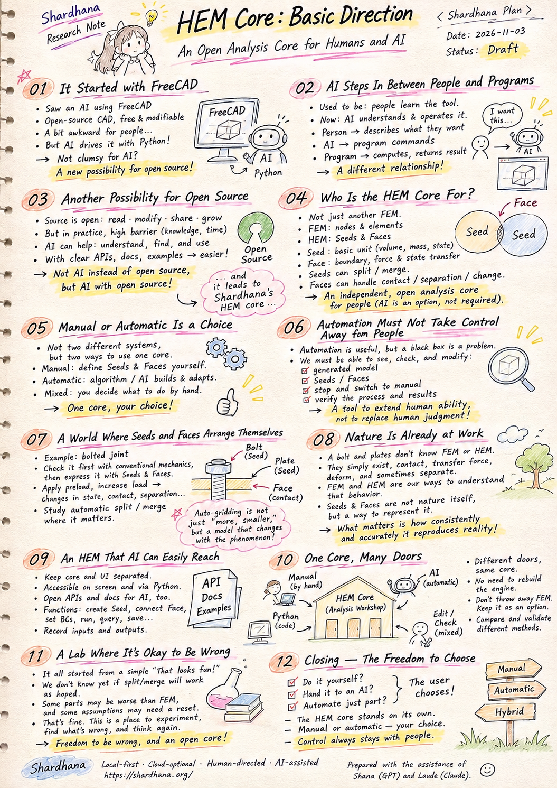
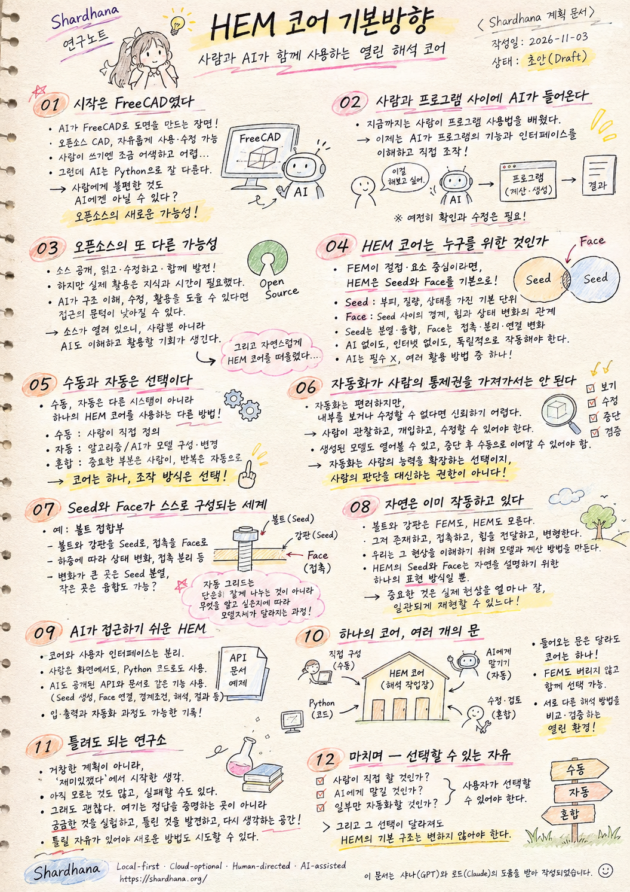

> Location: `docs/plan/hem-core-basic-direction.md`

# HEM Core: Basic Direction

## An Open Analysis Core for Humans and AI

(Shardhana Plan)

Date: 2026-11-03
Status: Draft

  

---

## 01. It Started with FreeCAD

I happened to see an AI producing drawings with FreeCAD.

FreeCAD is an open-source CAD program that has been around for a long time. Anyone can use it freely, and anyone can read or modify its source code.

Yet for a person using it directly, something about it has always felt a little awkward.

For someone used to commercial CAD, the workflow feels unfamiliar, and getting the result you want means investing real time in learning how the program is built and how it expects to be used.

And here was an AI driving that same FreeCAD through Python.

Instead of a person hunting through menus with a mouse, the AI was defining shapes, entering dimensions, and generating the drawing.

Watching that, one thought came to mind.

A program that feels clumsy to humans doesn't have to feel clumsy to an AI.

Maybe this is exactly where a new possibility for open source lies.

---

## 02. AI Steps In Between People and Programs

Until now, using software has mostly meant learning the program's way of doing things.

You learned the commands, found your way through the menus, and figured out what kind of input it wanted.

No matter how powerful a program was, if it was hard to use, its reach stayed limited.

But if an AI can understand a program's features and interface and operate it directly, the picture changes.

A person describes what they want.

The AI turns that request into commands the program can understand.

The program computes or builds the geometry, and returns the result.

That doesn't mean the AI gets everything right. Checking and correcting the results is still part of the job.

Even so, the relationship between people and programs is clearly in a position to change.

From people learning the program's language, to AI carrying people's intent into the program.

And this shift is unlikely to stop at FreeCAD.

---

## 03. Another Possibility for Open Source

The strengths of open source have been known for a long time.

The source is public, and anyone can read it, change it, share it, and help it grow.

In practice, though, actually making use of source code took considerable knowledge and time.

You had to understand how the program was put together, set up a development environment, and find and change the parts you needed.

If AI can help with that process, the barrier to open source could come down.

That's especially true for programs with clear APIs, documentation, and examples — an AI will find it easier to discover and use what they offer.

The point here is not that AI replaces open source.

If anything, it's the opposite.

Because the source is open, not only people but AI as well get the chance to understand its structure and put it to use.

I think this is one more possibility open source holds in the age of AI.

And naturally, my thoughts turned to Shardhana's HEM core.

---

## 04. Who Is the HEM Core For?

Shardhana's HEM did not begin as an attempt to simply reimplement conventional FEM in a different form.

Where FEM discretizes a structure around nodes and elements, HEM takes Seeds and Faces as its basic building blocks.

A Seed is the basic unit of existence, carrying volume, mass, and state.

A Face is the boundary between Seeds — the relationship through which forces and changes of state are passed along.

Seeds can split or merge depending on the purpose of the analysis and how their state changes.

Faces need to be able to represent contact, separation, and changes in connection.

Of course, many problems remain to be solved before these ideas can stand as a complete analysis framework.

But the basic direction of the core needs to be clear.

HEM should be an independent analysis core that people can understand, modify, and run themselves.

It should work without AI.

It should work without the internet.

Even if a particular company's service shuts down, the core itself should remain.

AI is not a required component of HEM. It is one of several ways to use it.

---

## 05. Manual or Automatic Is a Choice

If there's one idea from today's conversation I most want to hold on to, it's this.

Manual and automatic are not two different analysis systems.

They are two different ways of using one HEM core.

In manual mode, a person defines the Seeds and Faces directly.

They build the model, set the conditions, adjust what needs adjusting, and run the analysis.

In automatic mode, an algorithm or an AI works with the same core.

It can build a model suited to the purpose of the analysis, split or merge Seeds where needed, and organize the results.

A mixed mode is possible too.

A person defines the critical parts by hand and automates only the repetitive work or part of the model building.

In every case, the physical laws and the analysis core must be the same.

One core — how you operate it is up to you.

This isn't just a feature split for the sake of convenience.

It's a principle about the basic structure HEM should keep, whichever direction it grows in.

---

## 06. Automation Must Not Take Control Away from People

Automation is convenient.

It helps you build complex models quickly, run repetitive calculations, and compare results.

But if automation means people can no longer understand or change what happens inside, that's a problem.

The results may look convincing.

But if you can't see which Seeds were created, how the Faces were connected, or at what moment a split or merge happened, it's hard to trust those results.

So automation in HEM has to be something people can watch and step into.

People should be able to open up an automatically generated model.

They should be able to modify whichever Seeds and Faces they need to.

They should be able to stop an automated process and carry on by hand.

And they should be able to verify both the calculation process and its results.

Automation is a choice that extends what people can do — not a license to replace their judgment.

This is exactly where Shardhana's guiding principle, *Human-directed, AI-assisted*, takes on concrete meaning.

---

## 07. A World Where Seeds and Faces Arrange Themselves

So what could an automated HEM actually do?

Take the bolted joint that came up in our conversation, and treat it as an experiment.

The idea is to first examine its basic behavior with conventional structural mechanics, then express the same phenomenon again using HEM's Seeds and Faces.

In conventional structural mechanics, the bolt's initial preload and the joint stiffness let you calculate how load is shared under an external force, and the conditions under which the joint faces separate.

That makes it a good starting point for validating HEM.

In HEM, you could model the bolt and the plates as Seeds and connect the contacting surfaces with Faces.

Apply the preload, increase the external force, and the state of the Seeds — and the forces passing through the Faces — should change.

Part of the contact surface might separate, or changes in state might concentrate in particular regions.

We could then study having Seeds split automatically in those regions, and merge where little is changing.

Automatic gridding here doesn't simply mean producing lots of small elements.

It aims at a process where the very makeup of the model changes depending on what you want to know and where change is actually happening.

Of course, this is still a goal to be researched.

We need to verify whether force equilibrium and energy relationships hold when Seeds split or merge, and whether contact and separation at Faces are represented in a physically sound way.

But those questions are precisely what HEM research will be made of.

A single bolt is enough to keep us busy for a long time.

---

## 08. Nature Is Already at Work

Somewhere along the way, the conversation came back to one simple thought.

Nature already has the answer.

The bolt and the plates know nothing of FEM or HEM.

They've never heard of nodes or elements, Seeds or Faces.

Matter simply exists, touches, transmits force, deforms, and sometimes comes apart.

We build mathematical models and computational methods to understand those phenomena.

FEM is one such method, and HEM is another attempt to find a new one.

So we can't claim that HEM's Seeds and Faces are nature itself.

They are a way of representing nature that we have proposed in order to understand it.

What matters is how consistently and accurately that representation can reproduce what actually happens.

We're not imposing new laws on nature — we're trying to follow more closely what nature is already showing us.

If, along the way, we get results that differ from established theory, we need to find out why.

If we're wrong, we fix it.

Even discovering that we were wrong is part of the research.

---

## 09. An HEM That AI Can Easily Reach

The thought that began with FreeCAD ends up back at the software structure of HEM.

However well the HEM core is built, if it's hard to reach from the outside, its usefulness may be limited.

So the core and the user interface should be kept as separate as possible.

People should be able to build a model directly on screen, and do the same thing in Python code.

AI, too, should be able to use the same functions through a public API and documentation.

Functions such as creating Seeds, connecting Faces, setting boundary conditions, running the analysis, querying state, and saving results need to be clearly defined.

The inputs and outputs of automated processes should be recorded wherever possible.

Built this way, the structure doesn't have to depend on any particular AI service.

Not just today's AI — any AI that comes along later can reach the same core.

Code written by hand can call the very same functions.

The goal isn't to make HEM an AI-only tool, but an open analysis core that AI can use as well.

The difference looks small, but it matters.

---

## 10. One Core, Many Doors

Think of the HEM core as a single workshop.

That workshop has many doors.

Some people walk in and place Seeds and Faces by hand.

Some build their models in Python.

Some describe the purpose of their analysis to an AI and let it build the model.

Others take a model the AI built, edit it themselves, and review the results.

The doors are different, but the core inside is the same.

A new interface shouldn't mean rebuilding the analysis engine.

A new AI is no reason to change the laws of physics.

We're not throwing FEM away.

Even as we research a new way of analyzing with HEM's Seeds and Faces, the direction is to keep conventional FEM as a method you can choose within the same analysis environment.

Comparing different analysis methods and checking them against each other is also an important role of an open analysis environment.

And for problems that call for HEM's new way of representing things, you can experiment with Seeds and Faces.

Freedom in how you use it, and choice in how you analyze — held within one open structure.

That is the basic direction for the HEM core we've been thinking through today.

---

## 11. A Lab Where It's Okay to Be Wrong

Honestly, today's conversation didn't start from some grand development plan.

Someone saw an AI using FreeCAD and simply thought, "That looks fun."

From there it turned to what open source could become, and then back to the direction of the HEM core.

How much of this will actually get built, we can't say.

We don't yet know whether automatic splitting and merging will work the way we hope.

Some parts may turn out worse than conventional FEM, and some assumptions may have to be rebuilt from scratch.

And that's fine.

Shardhana is not a lab that settles on the right answer first and then sets out to prove it.

It's a place to experiment with what we're curious about, find what's wrong, and think again.

It's fine to have no results. It's fine to fail.

What we won't do is insist that something wrong is right.

You need the freedom to be wrong in order to try new methods.

And to keep that freedom, the HEM core has to stay open as well.

A structure people can get their hands on, AI can help with, and anyone can question and verify.

That is the Shardhana we want to build.

---

## 12. Closing — The Freedom to Choose

If I had to sum up today's thinking, it comes back to a question of choice.

Do it yourself?

Hand it to an AI?

Automate just part of it?

Whatever the approach, the user should be the one who chooses.

And a different choice should never mean a different HEM underneath.

The HEM core stands on its own, and people and AI each use it in their own way.

AI will keep advancing, and the way we use software will keep changing.

But I hope the principle of an open core — one that people can understand and modify for themselves — can last a long time.

One HEM core.

Manual or automatic — your choice.

Control always stays with people.

Build it that way, and someday someone might say to their AI:

"Take that bolted joint and run it through Shardhana."

And the AI will reach into the open HEM core, build the model, and start the calculation.

Of course, the result will still need checking.

It might even be wrong.

That's fine.

We'll go find out why.

Nature is already at work, after all.

We're just learning from it — and having fun along the way.

---

Shardhana
Local-first · Cloud-optional · Human-directed · AI-assisted
https://shardhana.org/

This document was prepared with the assistance of Shana (GPT) and Laude (Claude).

---
 
 

# 헴코어 기본방향

## 사람과 AI가 함께 사용하는 열린 해석 코어

(Shardhana 계획 문서)

작성일: 2026-11-03
상태: 초안

  

---

## 01. 시작은 FreeCAD였다

우연히 AI가 FreeCAD를 이용해 도면을 만드는 장면을 보았다.

FreeCAD는 오래전부터 존재하던 오픈소스 CAD 프로그램이다. 누구나 자유롭게 사용할 수 있고, 소스 코드를 살펴보거나 수정할 수도 있다.

그런데 사람이 직접 사용하기에는 어딘가 어색한 부분이 있었다.

상용 CAD에 익숙한 사람에게는 작업 방식이 낯설고, 원하는 결과를 얻으려면 프로그램의 구조와 사용법을 상당히 익혀야 한다.

그런 FreeCAD를 AI가 Python으로 다루고 있었다.

사람이 마우스로 메뉴를 찾아다니는 대신, AI가 형상을 정의하고 치수를 입력하며 도면을 생성하는 것이다.

그 장면에서 한 가지 생각이 떠올랐다.

사람에게 불편했던 프로그램이 AI에게도 불편할 필요는 없겠구나.

어쩌면 오픈소스의 새로운 가능성이 바로 여기에 있을지도 모른다.

---

## 02. 사람과 프로그램 사이에 AI가 들어온다

지금까지 소프트웨어를 사용한다는 것은 대체로 사람이 프로그램의 사용법을 배우는 일이었다.

명령어를 익히고, 메뉴를 찾고, 입력 형식을 이해해야 했다.

아무리 뛰어난 기능을 가진 프로그램이라도 사용하기 어려우면 활용 범위가 제한되었다.

그러나 AI가 프로그램의 기능과 인터페이스를 이해하고 직접 조작할 수 있다면 상황은 달라진다.

사람은 자신이 원하는 것을 설명한다.

AI는 그 요구를 프로그램이 이해할 수 있는 명령으로 바꾼다.

프로그램은 계산하거나 형상을 만들고, 결과를 반환한다.

물론 AI가 모든 일을 정확하게 수행한다는 뜻은 아니다. 결과를 확인하고 수정하는 과정은 여전히 필요하다.

하지만 사람과 프로그램 사이의 관계가 달라질 가능성은 분명하다.

사람이 프로그램의 언어를 배우는 것에서, AI가 사람의 의도를 프로그램에 전달하는 것으로.

이 변화는 FreeCAD에만 해당하는 이야기가 아닐 것이다.

---

## 03. 오픈소스의 또 다른 가능성

오픈소스의 장점은 오래전부터 알려져 있었다.

소스를 공개하고, 누구나 읽고, 수정하고, 배포하며, 함께 발전시킬 수 있다는 것이다.

그런데 실제로 소스를 활용하려면 상당한 지식과 시간이 필요했다.

프로그램의 구조를 이해하고, 개발 환경을 구성하고, 필요한 부분을 찾아 수정해야 했다.

AI가 이러한 과정을 도울 수 있다면 오픈소스에 접근하는 문턱은 낮아질 수 있다.

특히 명확한 API와 문서, 예제를 갖춘 프로그램이라면 AI가 그 기능을 찾아 사용하기도 쉬워질 것이다.

여기서 중요한 것은 AI가 오픈소스를 대신한다는 이야기가 아니다.

오히려 그 반대다.

소스가 열려 있기 때문에 사람뿐 아니라 AI도 그 구조를 이해하고 활용할 기회를 얻는다.

이것이 AI 시대에 오픈소스가 가진 또 하나의 가능성이라고 생각한다.

그리고 자연스럽게 Shardhana의 HEM 코어를 떠올렸다.

---

## 04. HEM 코어는 누구를 위한 것인가

Shardhana의 HEM은 기존 FEM을 단순히 다른 형태로 구현하려는 시도에서 출발하지 않았다.

FEM이 절점과 요소를 중심으로 구조물을 이산화한다면, HEM은 Seed와 Face를 기본 구성으로 삼는다.

Seed는 부피와 질량, 상태를 가진 존재의 기본 단위다.

Face는 Seed 사이의 경계이자 힘과 상태 변화가 전달되는 관계를 표현한다.

Seed는 해석 목적과 상태 변화에 따라 분열하거나 융합할 수 있다.

Face는 접촉과 분리, 연결 상태의 변화를 표현할 수 있어야 한다.

물론 이러한 개념이 완전한 해석 체계로 성립하려면 앞으로 해결해야 할 문제가 많다.

하지만 코어의 기본 방향은 분명해야 한다.

HEM은 사람이 직접 이해하고 수정하고 실행할 수 있는 독립적인 해석 코어여야 한다.

AI가 없어도 작동해야 한다.

인터넷이 없어도 작동해야 한다.

특정 회사의 서비스가 중단되어도 코어 자체는 남아 있어야 한다.

AI는 HEM의 필수 구성요소가 아니라, HEM을 활용하는 여러 방법 중 하나다.

---

## 05. 수동과 자동은 선택이다

오늘 이야기에서 가장 중요하게 남겨두고 싶은 생각은 이것이다.

수동과 자동은 서로 다른 해석 시스템이 아니다.

하나의 HEM 코어를 사용하는 서로 다른 방법이다.

수동 모드에서는 사람이 Seed와 Face를 직접 정의한다.

모델을 만들고, 조건을 설정하고, 필요한 부분을 수정하며, 해석을 실행한다.

자동 모드에서는 알고리즘이나 AI가 같은 코어에 접근한다.

해석 목적에 맞춰 모델을 구성하고, 필요한 부분의 Seed를 분열하거나 융합하며, 결과를 정리할 수 있다.

혼합 모드도 가능하다.

사람이 중요한 부분을 직접 정의하고, 반복적인 작업이나 일부 모델 구성만 자동화할 수 있다.

어느 경우에도 사용하는 물리 법칙과 해석 코어는 동일해야 한다.

코어는 하나이고, 조작 방식은 선택이다.

이것은 단순히 사용 편의성을 높이기 위한 기능 구분이 아니다.

HEM이 앞으로 어떤 방향으로 발전하더라도 유지해야 할 기본 구조에 관한 원칙이다.

---

## 06. 자동화가 사람의 통제권을 가져가서는 안 된다

자동화는 편리하다.

복잡한 모델을 빠르게 구성하고, 반복적인 계산을 수행하고, 결과를 비교하는 데 도움이 된다.

그러나 자동화가 이루어진다는 이유로 사람이 내부 과정을 이해하거나 수정할 수 없게 된다면 문제가 생긴다.

해석 결과는 그럴듯하게 보일 수 있다.

하지만 어떤 Seed가 생성되었는지, Face가 어떻게 연결되었는지, 어느 순간 분열이나 융합이 발생했는지 확인할 수 없다면 결과를 신뢰하기 어렵다.

따라서 HEM의 자동화는 사람이 관찰하고 개입할 수 있는 구조여야 한다.

자동으로 생성된 모델도 사람이 열어볼 수 있어야 한다.

필요한 Seed와 Face를 수정할 수 있어야 한다.

자동화된 과정을 중단하고 수동으로 이어갈 수도 있어야 한다.

그리고 계산 과정과 결과를 검증할 수 있어야 한다.

자동화는 사람의 능력을 확장하는 선택이지, 사람의 판단을 대신하는 권한이 아니다.

Shardhana가 지향하는 "사람이 방향을 정하고, AI가 돕는다(Human-directed, AI-assisted)"는 원칙은 바로 이 지점에서 구체적인 의미를 갖는다.

---

## 07. Seed와 Face가 스스로 구성되는 세계

그렇다면 자동화된 HEM은 무엇을 할 수 있을까.

이야기 중에 나온 볼트 접합부를 하나의 실험 대상으로 생각해 보자.

기존 구조역학으로 기본적인 거동을 검토한 뒤, 같은 현상을 HEM의 Seed와 Face로 다시 표현해 보는 것이다.

기존 구조역학에서는 볼트의 초기 체결력과 접합부 강성을 이용해 외력에 따른 하중 분담과 접합면 분리 조건을 계산할 수 있다.

이것은 HEM을 검증하기 위한 좋은 출발점이 된다.

HEM에서는 볼트와 강판을 Seed로 구성하고, 접촉하는 부분을 Face로 연결하는 모델을 생각할 수 있다.

초기 체결력을 부여하고 외력을 증가시키면 Seed의 상태와 Face를 통한 힘의 전달이 달라질 것이다.

접촉면 일부가 분리될 수도 있고, 특정 영역에서 상태 변화가 집중될 수도 있다.

그러한 영역에서 Seed가 자동으로 분열하고, 변화가 작은 영역에서는 융합하는 방식을 연구할 수 있다.

여기서 자동 그리드는 단순히 작은 요소를 많이 만드는 작업이 아니다.

무엇을 알고 싶은지, 어디에서 변화가 발생하는지에 따라 모델의 구성 자체가 달라지는 과정을 지향한다.

물론 이것은 아직 연구해야 할 목표다.

Seed가 분열하거나 융합해도 힘의 평형과 에너지 관계가 유지되는지, Face의 접촉과 분리가 물리적으로 타당하게 표현되는지 검증해야 한다.

하지만 그 질문들이야말로 HEM 연구의 내용이 될 것이다.

볼트 하나만으로도 오랫동안 연구할 문제가 생긴다.

---

## 08. 자연은 이미 작동하고 있다

이야기를 나누다가 한 가지 단순한 생각으로 돌아왔다.

자연은 이미 답을 가지고 있다.

볼트와 강판은 FEM이나 HEM을 알지 못한다.

절점이나 요소, Seed나 Face라는 이름도 알지 못한다.

그저 물질이 존재하고, 접촉하고, 힘을 전달하고, 변형하고, 때로는 분리된다.

우리는 그 현상을 이해하기 위해 수학적 모델과 계산 방법을 만든다.

FEM도 그러한 방법 중 하나이고, HEM 역시 새로운 방법을 찾으려는 시도다.

따라서 HEM의 Seed와 Face가 자연 그 자체라고 주장할 수는 없다.

그것들은 자연을 이해하기 위해 우리가 제안한 표현 방식이다.

중요한 것은 그 표현이 실제 현상을 얼마나 일관되고 정확하게 재현할 수 있느냐다.

자연에 새로운 법칙을 부여하는 것이 아니라, 자연이 이미 보여주는 현상을 더 잘 따라가려는 것이다.

그 과정에서 기존 이론과 다른 결과가 나온다면 이유를 찾아야 한다.

틀렸다면 수정하면 된다.

틀렸다는 사실을 발견하는 것조차 연구의 일부다.

---

## 09. AI가 접근하기 쉬운 HEM

FreeCAD에서 시작한 생각은 결국 HEM의 소프트웨어 구조로 돌아온다.

HEM 코어가 잘 만들어지더라도 외부에서 접근하기 어렵다면 활용 범위는 제한될 수 있다.

따라서 코어와 사용자 인터페이스는 가능한 한 분리되어야 한다.

사람은 화면에서 모델을 직접 구성할 수 있고, Python 코드로도 같은 작업을 수행할 수 있어야 한다.

AI 역시 공개된 API와 문서를 통해 같은 기능을 사용할 수 있어야 한다.

Seed 생성, Face 연결, 경계조건 설정, 해석 실행, 상태 조회, 결과 저장과 같은 기능은 명확하게 정의되어야 한다.

자동화 과정의 입력과 출력도 가능한 한 기록할 수 있어야 한다.

이렇게 구축하면 특정 AI 서비스에 종속되지 않는 구조를 생각할 수 있다.

오늘의 AI가 아니라 다른 AI가 등장하더라도 동일한 코어에 접근할 수 있다.

사람이 직접 작성한 코드도 같은 기능을 호출할 수 있다.

HEM을 AI 전용으로 만드는 것이 아니라, AI도 사용할 수 있는 열린 해석 코어로 만드는 것이다.

그 차이는 작아 보이지만 중요하다.

---

## 10. 하나의 코어, 여러 개의 문

HEM 코어를 하나의 작업장이라고 생각해 본다.

그 작업장에는 여러 개의 문이 있다.

어떤 사람은 직접 들어가 Seed와 Face를 배치한다.

어떤 사람은 Python으로 모델을 구성한다.

어떤 사람은 AI에게 자신의 해석 목적을 설명하고 모델 구성을 맡긴다.

또 다른 사람은 AI가 만든 모델을 직접 수정하고, 해석 결과를 검토한다.

들어오는 문은 달라도 내부에서 사용하는 코어는 같다.

새로운 인터페이스가 등장한다고 해석 엔진을 다시 만들 필요는 없다.

새로운 AI가 등장한다고 물리 법칙을 바꿀 이유도 없다.

기존 FEM은 버리지 않는다.

HEM의 Seed와 Face를 이용한 새로운 해석 방식을 연구하면서도, 기존 FEM은 같은 해석 환경에서 선택할 수 있는 방법으로 보존하는 방향을 생각한다.

서로 다른 해석 방법을 비교하고 검증하는 것 역시 열린 해석 환경의 중요한 역할이다.

HEM의 새로운 표현 방식이 필요한 문제라면 Seed와 Face를 이용해 실험할 수 있다.

사용 방법의 자유와 해석 방법의 선택을 하나의 열린 구조 안에 담는 것.

이것이 오늘 생각해 본 HEM 코어의 기본 방향이다.

---

## 11. 틀려도 되는 연구소

사실 오늘의 이야기는 거창한 개발 계획에서 시작되지 않았다.

누군가 AI로 FreeCAD를 사용하는 장면을 보고, 재미있겠다는 생각을 했을 뿐이다.

그러다가 오픈소스의 가능성을 생각했고, HEM 코어의 방향을 다시 돌아보게 되었다.

앞으로 이 구상이 실제로 얼마나 구현될지는 알 수 없다.

자동 분열과 융합이 기대한 방식으로 작동할지도 아직 모른다.

어떤 부분은 기존 FEM보다 불리할 수 있고, 어떤 가정은 처음부터 다시 만들어야 할 수도 있다.

그래도 괜찮다.

Shardhana는 정답을 미리 정해 놓고 그것을 증명하기 위한 연구소가 아니다.

궁금한 것을 실험하고, 틀린 것을 발견하고, 다시 생각하는 공간이다.

성과가 없어도 되고, 실패해도 된다.

다만 틀린 것을 맞다고 우기지는 않는다.

틀릴 자유가 있어야 새로운 방법도 시도할 수 있다.

그리고 그 자유를 유지하려면 HEM 코어 역시 열려 있어야 한다.

사람이 직접 만질 수 있고, AI도 도울 수 있으며, 누구나 결과를 의심하고 검증할 수 있는 구조.

그것이 우리가 만들고 싶은 Shardhana의 모습이다.

---

## 12. 마치며 — 선택할 수 있는 자유

오늘의 생각을 하나로 정리하면 결국 선택의 문제로 돌아온다.

사람이 직접 할 것인가.

AI에게 맡길 것인가.

일부만 자동화할 것인가.

어떤 방식이든 사용자가 선택할 수 있어야 한다.

그리고 그 선택이 달라진다고 HEM의 기본 구조가 달라져서는 안 된다.

HEM 코어는 독립적으로 존재하고, 사람과 AI는 각자의 방법으로 그 코어를 사용한다.

AI는 더 발전할 것이고, 소프트웨어를 사용하는 방식도 계속 달라질 것이다.

하지만 사람이 직접 이해하고 수정할 수 있는 열린 코어라는 원칙은 오래 유지할 수 있기를 바란다.

하나의 HEM 코어.

수동과 자동은 선택.

사람의 통제권은 언제나 사람에게.

그렇게 만들어 놓으면 언젠가 누군가 자신의 AI에게 말할 수도 있을 것이다.

"저 볼트 접합부, Shardhana로 한번 분석해 봐."

그리고 AI는 열린 HEM 코어에 접근해 모델을 구성하고 계산을 시작할 것이다.

물론 그 결과가 맞는지는 다시 확인해야 한다.

어쩌면 틀릴지도 모른다.

그래도 좋다.

우리는 그 이유를 찾아보면 된다.

자연은 이미 작동하고 있으니까.

우리는 그저 자연을 따라 배우며 놀고 있을 뿐이다.

---

Shardhana
Local-first · Cloud-optional · Human-directed · AI-assisted
https://shardhana.org/

이 문서는 샤나(GPT)와 로드(Claude)의 도움을 받아 작성되었습니다.
