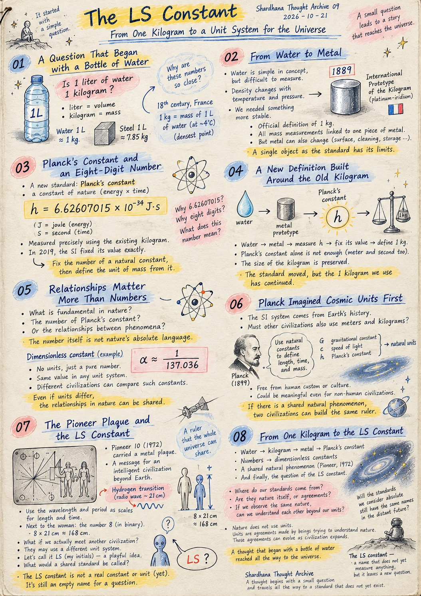
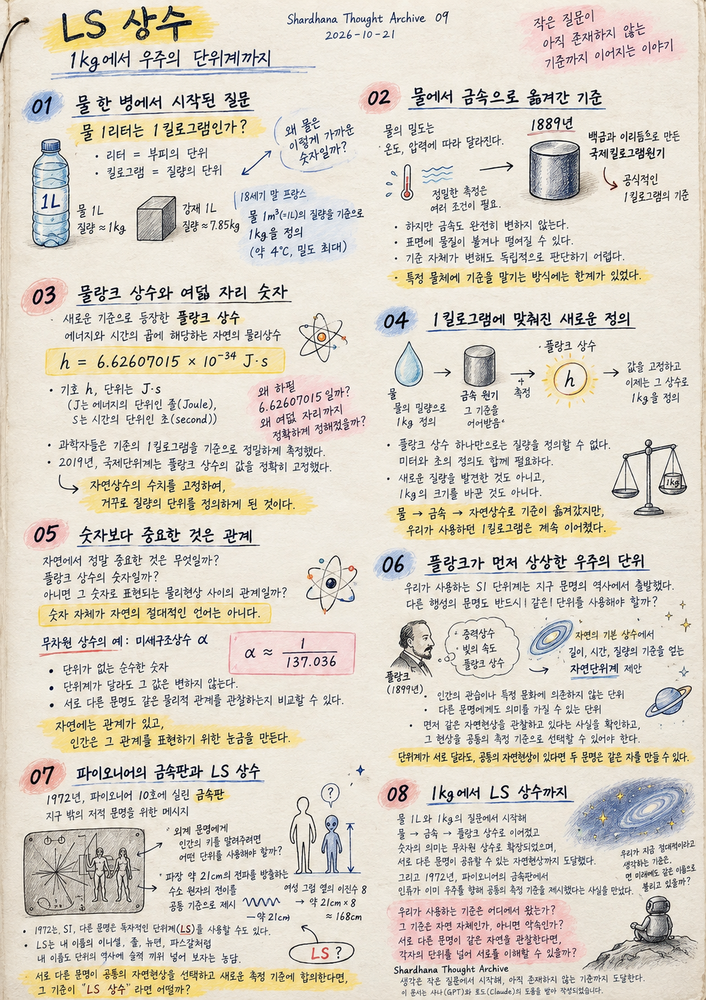

Location: docs/thoughts/LS-constant.md

# The LS Constant
From One Kilogram to a Unit System for the Universe

*(Shardhana Thought Archive)*  
*Date: 2026-10-21*

  

⸻

## 01. A Question That Began with a Bottle of Water

Is one liter of water one kilogram?

In daily life we treat the two as practically the same. But a liter measures volume, and a kilogram measures mass.

One liter of water has a mass of about one kilogram. One liter of structural steel, by contrast, has a mass of about 7.85 kilograms.

Yet the fact that water's volume and mass line up so neatly is no coincidence.

When France built a new system of weights and measures at the end of the 18th century, the kilogram was defined by water itself: the mass of one cubic decimeter — one liter — of water at about 4°C, the temperature at which water is densest.

Humans used the water that nature provided to carve the first marks on the scale of mass.

But did that standard stay put?

A question that began with a bottle of water turned into the history of the kilogram.

⸻

## 02. From Water to Metal

Defining mass by water is simple in concept, but hard in practice.

Water's density shifts with temperature and pressure, and precise measurement means controlling a long list of conditions.

What was needed was an object that could be stored and compared more reliably.

So the standard of mass moved into metal.

In 1889, the International Prototype of the Kilogram — a cylinder of platinum and iridium — became the official definition of one kilogram.

Every mass measurement in the world was now tied to a single lump of metal kept in France.

But even metal is not perfectly unchanging.

Material can settle on its surface or wear away from it, and cleaning and storage can introduce tiny changes.

The deeper problem was this: if the standard itself changed, there was no independent way to tell.

Entrusting the kilogram to one particular object had its limits.

Humanity began preparing to move the standard once again.

⸻

## 03. Planck's Constant and an Eight-Digit Number

The new standard was Planck's constant.

Planck's constant is a physical constant of nature whose dimensions are energy multiplied by time.

Its symbol is h, and its unit is J·s: J for the joule, the unit of energy, and s for the second, the unit of time.

Its value is:

h = 6.62607015 × 10⁻³⁴ J·s

Looking at this number, I started to wonder.

Why 6.62607015, of all things?

Why is it fixed so exactly, to eight decimal places?

Planck's constant is not a number humans invented. It is a physical constant discovered and measured in nature.

But which number we use to express it depends on the unit system we use.

Scientists measured Planck's constant with great precision, using the existing kilogram as their reference.

Then, in 2019, the International System of Units fixed its value at exactly 6.62607015 × 10⁻³⁴ J·s.

The number for a constant of nature was fixed first, and the unit of mass was then defined from it — the other way around.

⸻

## 04. A New Definition Built Around the Old Kilogram

At first this felt a little strange.

Fix the number for Planck's constant, then use that number to define the kilogram?

But walking through the sequence backward makes it easy to follow.

First, the kilogram was made from the mass of water.

Then the metal prototype inherited that standard.

Using that kilogram, scientists measured Planck's constant precisely.

Finally, they fixed the measured value — and now the kilogram is defined by the constant.

Of course, Planck's constant alone does not define mass. The definitions of the meter and the second are needed too.

What matters is that the size of the kilogram was preserved.

No new mass was discovered, and the kilogram did not suddenly change size.

The standard simply moved: from water, to metal, to a constant of nature.

The reference changed, but the kilogram we had always used carried on.

⸻

## 05. Relationships Matter More Than Numbers

So what is truly fundamental in nature?

The number we write for Planck's constant?

Or the relationships between physical phenomena that the number describes?

In SI units, Planck's constant is 6.62607015 × 10⁻³⁴ J·s.

In a different unit system, the same constant would appear as a different number.

The number itself is not nature's absolute language.

This is where dimensionless constants come in.

The best-known example is the fine-structure constant, α.

α ≈ 1/137.036

It is a pure number, with no units at all.

Whether you measure in meters and seconds or in entirely different units of length and time, its value under the same physical conditions does not change.

Even if two civilizations each have their own unit system, they could compare dimensionless constants like this to check whether they are observing the same physical relationships.

Dimensionless constants cannot, on their own, convert one civilization's masses or lengths into the other's.

But they do reveal something important:

even when units differ, the relationships between natural phenomena can be shared.

Nature holds the relationships. Humans make the scales to express them.

⸻

## 06. Planck Imagined Cosmic Units First

At this point my thoughts drifted beyond Earth.

The SI system grew out of the history of one civilization on Earth.

Would a civilization that developed on another planet have to use meters and kilograms too?

Remarkably, Planck had a similar thought long ago.

In 1899, he proposed a system of natural units built from constants such as the gravitational constant, the speed of light, and Planck's constant.

The aim was to derive standards of length, time, and mass from the fundamental constants of nature, free from human custom or any particular culture.

The idea was that such units could carry meaning even for civilizations that are not human.

So how could Earth's SI units be connected to the units of another civilization?

First, both sides would need to confirm that they are observing the same natural phenomena.

Then they would need to choose one of those phenomena as a shared measuring standard.

Different unit systems or not, if there is a shared phenomenon, two civilizations can build the same ruler.

This was not pure fantasy.

Humanity had already tried something like it.

⸻

## 07. The Pioneer Plaque and the LS Constant

Pioneer 10, launched in 1972, carried a special metal plaque.

Engraved on it were figures of human beings, a map of the solar system, and the spacecraft's point of departure.

It was a message made in the hope that an intelligent civilization beyond Earth might one day find it.

But there was a problem.

To tell an alien civilization how tall humans are, what unit would you use?

Writing "1.7 meters" means nothing to someone who has never heard of a meter.

So the plaque presented a shared standard: a transition in the hydrogen atom that emits radio waves with a wavelength of about 21 cm.

The wavelength and period of the radiation from this specific hydrogen transition served as the scales for length and time.

Next to the figure of the woman, the number 8 is engraved in binary.

It means eight times the 21 cm wavelength of the hydrogen transition — about 168 cm.

To explain its own height, humanity held out a ruler that the whole universe could share — a natural phenomenon instead of Earth's meter.

That scene sparked another thought.

What if, in the distant future, Earth's civilization actually met another?

Earth would use SI units, while the other civilization might use a system of its own, grown out of its own history.

For convenience, I decided to call that system LS.

LS is simply my initials.

It started as a joke — a small attempt to slip my name into the history of units, the way the joule, the newton, and the pascal carry the names of Joule, Newton, and Pascal.

But even inside the joke, a question remained.

If two civilizations with different units chose a shared natural phenomenon and agreed on a new standard of measurement, what would that standard be called?

What if it were called the LS constant?

Of course, the LS constant is neither a discovered physical constant nor a defined unit.

Pioneer's hydrogen transition was a real, shared ruler that was actually offered. The LS constant is still an empty name.

What standard could different civilizations share in order to understand one and the same nature?

The LS constant is a small name I've given to that question.

⸻

## 08. From One Kilogram to the LS Constant

The first question was about one liter of water and one kilogram.

It led to the history of a kilogram that was once defined by water.

The standard of mass moved into a metal prototype, and then became tied to Planck's constant.

Asking what the numbers mean led to dimensionless constants, and on to natural phenomena that different civilizations could share.

And on the Pioneer plaque of 1972, I found that humanity had already offered the universe a shared standard of measurement.

Looking back, the heart of the question never really changed.

Where do our standards come from?

Are they nature itself, or agreements we made in order to describe nature?

If different civilizations observe the same nature, can they understand one another beyond their own units?

Today, the kilogram is tied to Planck's constant.

In the distant future, SI units may still be in use — or the unit system of a new civilization may appear.

Perhaps by then we will use units with names entirely different from today's.

But what matters will not be the names or the numbers.

It will be the fact that, even measuring with different scales, we can understand and compare the same natural phenomena.

Nature does not use units.

Units are agreements made by beings trying to understand nature.

And those agreements can evolve into new forms as civilization expands.

A thought that began with a bottle of water reached all the way to the universe.

The LS constant.

A name that does not yet measure anything.

But it is enough to leave behind one new question:

Will the standards we now consider absolute still go by the same names in the distant future?

⸻

Shardhana Thought Archive
A thought begins with a small question and travels all the way to a standard that does not yet exist.

*This document was prepared with the assistance of Shana (GPT) and Laude (Claude).*

---
 
 

# LS상수
1kg에서 우주의 단위계까지

*(Shardhana Thought Archive)*  
*Date: 2026-10-21*

  

⸻

## 01. 물 한 병에서 시작된 질문

물 1리터는 1킬로그램인가?

일상에서는 거의 같은 것으로 취급하지만, 리터는 부피의 단위이고 킬로그램은 질량의 단위다.

물 1리터의 질량은 약 1킬로그램이다. 반면 강재 1리터의 질량은 약 7.85킬로그램이다.

그런데 물의 부피와 질량이 이렇게 가까운 숫자로 표현되는 것은 단순한 우연이 아니었다.

18세기 말 프랑스에서 새로운 도량형 체계를 만들 때, 킬로그램은 물의 질량을 기준으로 정해졌다. 약 4°C에서 밀도가 최대인 물 1세제곱데시미터, 즉 1리터의 질량이 기준이었다.

인간은 자연에 존재하는 물을 이용해 질량의 눈금을 만들었다.

그렇다면 이 기준은 이후에도 그대로 유지되었을까?

물 한 병에서 시작된 질문은 1킬로그램이라는 기준의 역사로 이어졌다.

⸻

## 02. 물에서 금속으로 옮겨간 기준

물을 기준으로 질량을 정의하는 것은 개념적으로 단순하지만, 실제 측정에서는 어려움이 있었다.

물의 밀도는 온도와 압력에 따라 달라지고, 정밀한 측정에는 여러 조건을 고려해야 한다.

인류는 더 안정적으로 보관하고 비교할 수 있는 물체를 필요로 했다.

그 결과 질량의 기준은 금속 원기로 옮겨갔다.

1889년에는 백금과 이리듐으로 만든 국제킬로그램원기가 공식적인 1킬로그램의 기준이 되었다.

세계의 질량 측정이 프랑스에 보관된 금속 덩어리 하나와 연결된 것이다.

그러나 금속도 완전히 변하지 않는 존재는 아니다.

표면에 물질이 붙거나 떨어질 수 있고, 세척과 보관 과정에서도 미세한 변화가 생길 수 있다.

더 근본적인 문제는 기준 자체가 변하더라도 그것을 독립적으로 판단하기 어렵다는 점이었다.

1킬로그램의 기준을 특정 물체에 맡기는 방식에는 한계가 있었다.

인류는 다시 기준을 옮길 준비를 시작했다.

⸻

## 03. 플랑크 상수와 여덟 자리 숫자

새로운 기준으로 등장한 것은 플랑크 상수였다.

플랑크 상수는 에너지와 시간의 곱에 해당하는 차원을 가진 자연의 물리상수다.

기호는 h, 단위는 J·s다.

여기서 J는 에너지의 단위인 줄(Joule), s는 시간의 단위인 초(second)를 뜻한다.

플랑크 상수의 값은 다음과 같다.

h = 6.62607015 × 10⁻³⁴ J·s

이 숫자를 보면서 의문이 생겼다.

왜 하필 6.62607015일까?

왜 소수점 아래 여덟 자리까지 정확하게 정해져 있을까?

플랑크 상수는 인간이 만들어낸 숫자가 아니라 자연현상에서 발견하고 측정한 물리상수다.

그러나 그 상수를 어떤 숫자로 표현할지는 우리가 사용하는 단위계와 연결되어 있다.

과학자들은 기존의 킬로그램을 기준으로 플랑크 상수를 정밀하게 측정했다.

그리고 2019년, 국제단위계는 플랑크 상수의 수치를 정확히 6.62607015 × 10⁻³⁴ J·s로 고정했다.

자연상수의 수치를 고정하여, 거꾸로 질량의 단위를 정의하게 된 것이다.

⸻

## 04. 1킬로그램에 맞춰진 새로운 정의

처음에는 조금 이상하게 느껴졌다.

플랑크 상수의 숫자를 정해놓고, 그 숫자로 1킬로그램을 정의한다는 이야기였기 때문이다.

하지만 순서를 거꾸로 살펴보면 이해하기 쉬웠다.

처음에는 물의 질량을 기준으로 킬로그램을 만들었다.

이후 금속 원기가 그 기준을 이어받았다.

그리고 그 킬로그램을 기준으로 플랑크 상수를 정밀하게 측정했다.

마지막으로 측정된 플랑크 상수의 수치를 고정하고, 이제는 그 상수를 기준으로 킬로그램을 정의한다.

물론 플랑크 상수 하나만으로 질량을 정의하는 것은 아니다. 미터와 초의 정의도 함께 필요하다.

중요한 것은 기존 1킬로그램의 크기를 유지했다는 점이다.

새로운 질량을 발견한 것도 아니고, 갑자기 1킬로그램의 크기를 바꾼 것도 아니다.

물에서 금속으로, 다시 자연상수로 기준이 옮겨간 것이다.

측정의 기준은 달라졌지만, 우리가 사용하던 1킬로그램은 계속 이어졌다.

⸻

## 05. 숫자보다 중요한 것은 관계

그렇다면 자연에서 정말 중요한 것은 무엇일까?

플랑크 상수의 숫자일까?

아니면 그 숫자로 표현되는 물리현상 사이의 관계일까?

SI 단위계를 사용하면 플랑크 상수는 6.62607015 × 10⁻³⁴ J·s로 표현된다.

하지만 다른 단위계를 사용한다면 같은 상수도 다른 숫자로 나타날 수 있다.

숫자 자체가 자연의 절대적인 언어는 아니라는 뜻이다.

여기서 무차원 상수라는 개념이 등장한다.

대표적인 예가 미세구조상수 α다.

α ≈ 1/137.036

이 값은 단위가 없는 순수한 숫자다.

미터와 초를 사용하든, 전혀 다른 길이와 시간의 단위를 사용하든 같은 물리적 조건에서 그 값은 달라지지 않는다.

서로 다른 문명이 독자적인 단위계를 가지고 있더라도, 이러한 무차원 상수를 통해 같은 물리적 관계를 관찰하고 있는지 비교할 수 있다.

물론 무차원 상수만으로 서로의 질량이나 길이를 직접 환산할 수 있는 것은 아니다.

그러나 한 가지 중요한 사실을 알려준다.

단위가 달라도 자연현상 사이의 관계는 공유할 수 있다는 것.

자연에는 관계가 있고, 인간은 그 관계를 표현하기 위한 눈금을 만든다.

⸻

## 06. 플랑크가 먼저 상상한 우주의 단위

이쯤에서 생각은 지구 밖으로 향했다.

우리가 사용하는 SI 단위계는 지구 문명의 역사에서 출발했다.

그런데 다른 행성에서 발전한 문명도 반드시 미터와 킬로그램을 사용해야 할까?

놀랍게도 비슷한 생각을 플랑크가 이미 했다.

1899년, 플랑크는 중력상수, 빛의 속도, 플랑크 상수 등을 이용한 자연단위계를 제안했다.

인간의 관습이나 특정 문화에 의존하지 않고, 자연의 기본 상수에서 길이와 시간, 질량의 기준을 얻으려는 시도였다.

이러한 단위는 인간이 아닌 다른 문명에게도 의미를 가질 수 있다는 생각이었다.

그렇다면 지구 문명이 사용하는 SI 단위와 다른 문명이 사용하는 단위는 어떻게 연결될까?

먼저 서로가 같은 자연현상을 관찰하고 있다는 사실을 확인할 수 있어야 한다.

그리고 그 자연현상을 공통의 측정 기준으로 선택할 수 있어야 한다.

단위계가 서로 달라도, 공통의 자연현상이 있다면 두 문명은 같은 자를 만들 수 있다.

이것은 단순한 공상만은 아니었다.

인류는 이미 비슷한 시도를 한 적이 있었다.

⸻

## 07. 파이오니어의 금속판과 LS 상수

1972년 발사된 파이오니어 10호에는 특별한 금속판이 실려 있었다.

그 금속판에는 인간의 모습과 태양계, 우주선의 출발 위치 등을 나타내는 그림이 새겨져 있었다.

지구 밖의 지적 문명이 발견할 가능성을 상상하고 만든 메시지였다.

그런데 문제가 하나 있었다.

외계 문명에게 인간의 키를 알려주려면 어떤 단위를 사용해야 할까?

미터라는 단위를 모르는 문명에게 1.7미터라고 적어도 의미가 없을 것이다.

그래서 금속판에는 파장 약 21cm의 전파를 방출하는 수소 원자의 전이가 공통 기준으로 제시되었다.

수소 원자의 특정 전이에서 나오는 전파의 파장과 주기를 길이와 시간의 눈금으로 삼은 것이다.

금속판의 여성 그림 옆에는 이진수로 8이라는 숫자가 새겨져 있다.

그 의미는 수소 전이의 파장 약 21cm를 여덟 배 한 길이, 즉 약 168cm다.

인류는 자신의 키를 설명하기 위해 지구의 미터 대신 우주에서 공유할 수 있는 자연현상을 자로 내밀었던 것이다.

그 장면에서 또 하나의 상상이 떠올랐다.

먼 미래에 지구 문명과 다른 문명이 실제로 만난다면 어떨까?

지구는 SI 단위계를 사용하고, 다른 문명은 자신들의 역사에서 발전한 독자적인 단위계를 사용할 수 있다.

편의상 그 단위계를 LS라고 부르기로 했다.

LS는 내 이름의 이니셜이다.

줄(Joule), 뉴턴(Newton), 파스칼(Pascal)처럼 내 이름도 단위의 역사에 슬쩍 끼워 넣어 보자는 농담이었다.

하지만 농담 속에도 질문 하나는 남았다.

서로 다른 단위를 사용하는 두 문명이 공통의 자연현상을 선택하고 새로운 측정 기준에 합의한다면, 그 기준에는 어떤 이름이 붙을까?

그 이름이 LS 상수라면 어떨까?

물론 LS 상수는 아직 발견된 물리상수도, 실제로 정의된 단위도 아니다.

파이오니어의 수소 전이는 실제로 제시된 공통의 자였지만, LS 상수는 아직 비어 있는 이름이다.

서로 다른 문명이 하나의 자연을 이해하기 위해 어떤 기준을 공유할 수 있을까?

LS 상수는 그 질문에 붙여본 작은 이름이다.

⸻

## 08. 1kg에서 LS 상수까지

처음 질문은 물 1리터와 1킬로그램의 관계였다.

그 질문은 물을 기준으로 만든 킬로그램의 역사로 이어졌다.

질량의 기준은 금속 원기로 옮겨갔고, 다시 플랑크 상수와 연결되었다.

숫자의 의미를 묻던 생각은 무차원 상수로 확장되었고, 서로 다른 문명이 공유할 수 있는 자연현상까지 도달했다.

그리고 1972년 파이오니어의 금속판에서, 인류가 이미 우주를 향해 공통의 측정 기준을 제시했다는 사실을 만났다.

돌아보면 질문의 중심은 크게 달라지지 않았다.

우리가 사용하는 기준은 어디에서 왔는가?

그 기준은 자연 자체인가, 아니면 자연을 설명하기 위해 만든 약속인가?

서로 다른 문명이 같은 자연을 관찰한다면, 각자의 단위를 넘어 서로를 이해할 수 있을까?

오늘날 1킬로그램은 플랑크 상수와 연결되어 있다.

먼 미래에도 SI 단위계가 사용될 수 있고, 새로운 문명의 단위계가 등장할 수도 있다.

어쩌면 그때에는 지금과 전혀 다른 이름의 단위가 사용될지도 모른다.

하지만 중요한 것은 이름이나 숫자가 아닐 것이다.

서로 다른 눈금으로 측정하더라도 같은 자연현상을 이해하고 비교할 수 있다는 사실이다.

자연은 단위를 사용하지 않는다.

단위는 자연을 이해하려는 존재들이 만든 약속이다.

그리고 그 약속은 문명이 확장되는 만큼 새로운 형태로 발전할 수 있다.

물 한 병에서 시작한 생각이 우주까지 도달했다.

LS 상수.

아직은 아무것도 측정하지 않는 이름이다.

그러나 새로운 질문 하나를 남기기에는 충분하다.

우리가 지금 절대적이라고 생각하는 기준은, 먼 미래에도 같은 이름으로 불리고 있을까?

⸻

Shardhana Thought Archive
생각은 작은 질문에서 시작해, 아직 존재하지 않는 기준까지 도달한다.

*이 문서는 샤나(GPT)와 로드(Claude)의 도움으로 작성되었습니다.*