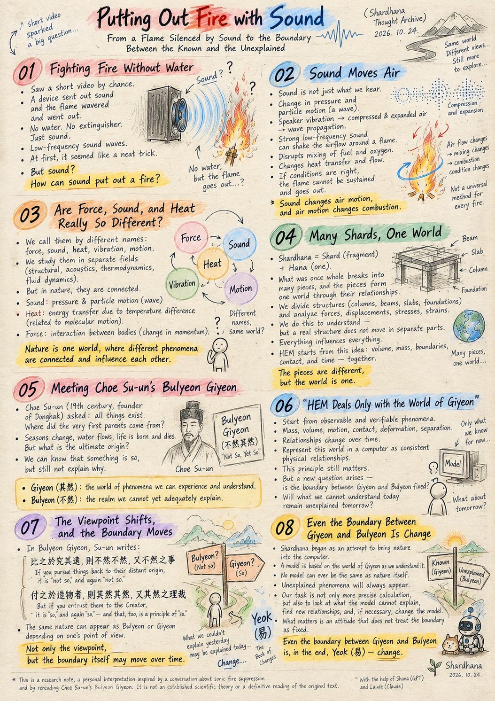
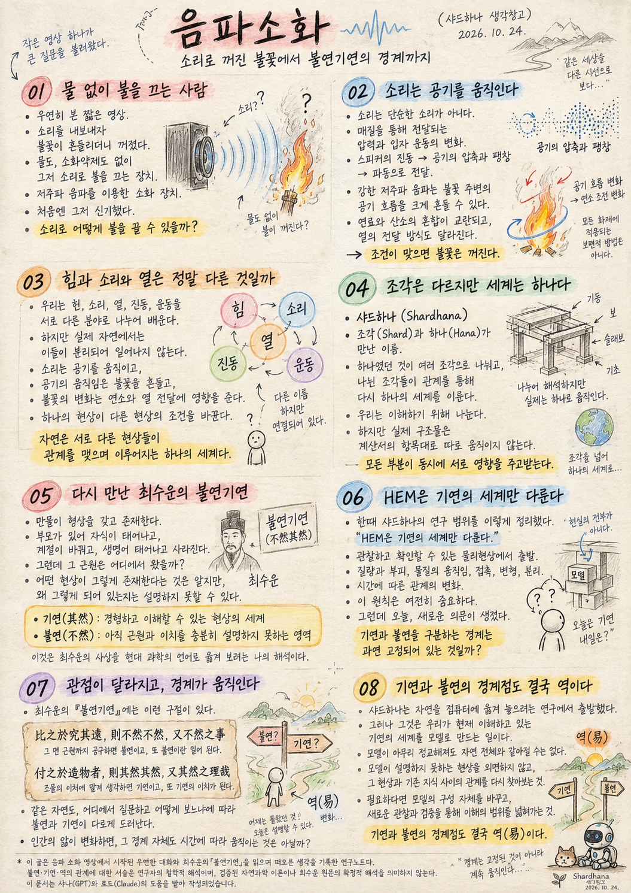

> Location: `docs/thoughts/Sonic_Fire_Suppression.md`

# Putting Out Fire with Sound

### From a Flame Silenced by Sound to the Boundary Between the Known and the Unexplained

(Shardhana Thought Archive)
Date: 2026-10-24

## 🎬 YouTube Video

[Watch on YouTube](https://youtu.be/5dDJKfasFW4)

  

---

## 01. Fighting Fire Without Water

By chance, I came across a short video.

Someone was aiming a device at a fire and sending out sound. In front of that sound, the flame wavered — and went out.

No water was sprayed. No extinguishing agent was released. It was simply a device that used sound to put out a fire.

The video described it as an extinguisher based on low-frequency sound waves.

At first, it just seemed like a neat trick.

When we think of putting out a fire, we think of water. We think of taking away heat, cutting off oxygen, or removing the fuel.

But sound?

It felt less like watching a way to fight fire, and more like watching two different physical phenomena meet.

And a question naturally followed.

How can sound put out a fire?

---

## 02. Sound Moves Air

Sound is more than information that reaches our ears.

Sound is a change in pressure and particle motion traveling through a medium. When a speaker vibrates, the surrounding air is compressed and expanded, and that disturbance travels outward as a wave.

A sufficiently strong low-frequency sound wave can shake the airflow around a flame quite violently.

A flame is combustion: fuel reacting with oxygen and releasing heat. To keep burning, it needs the right mixing, the right temperature, and the right reaction conditions to be sustained.

When sound waves push the surrounding air back and forth, the flame's shape and flow change.

The mixing of fuel and oxygen is disrupted, and the way heat moves can change as well.

Under the right conditions, the flame can no longer sustain itself, and it goes out.

Sound is not performing magic here — it does not erase the oxygen or directly cool the flame.

Sound changes the motion of the air, and the motion of the air changes the conditions for combustion.

This depends on the size of the flame, the type of fuel, the sound pressure, the frequency, the distance, and more. It is not a universal method that works on every fire.

---

## 03. Are Force, Sound, and Heat Really So Different?

Watching the flame go out, a thought came to me.

We call force "force," and sound "sound."

We learn that heat is heat, vibration is vibration, and motion is something else again.

So we study structural mechanics, acoustics, thermodynamics, and fluid dynamics as separate fields.

But in nature, these phenomena never happen in isolation.

Sound is a wave in which pressure and particle motion in a medium are passed along in an orderly way.

Heat is energy transferred because of a difference in temperature, and it is closely tied to the motion of molecules inside matter.

Force is an interaction between bodies that changes their momentum.

They are distinct concepts in physics — but they are connected, because in each case matter and energy are interacting and changing.

The speaker's vibration moves the air; the moving air shakes the flame; the changing flame affects combustion and the flow of heat.

One phenomenon changes the conditions of another.

Nature is a single world made of different phenomena in relationship with one another.

We gave things names and divided them into fields only so that we could understand them.

Nature was probably never divided that way to begin with.

---

## 04. Many Shards, One World

This line of thought led me back, naturally, to the name Shardhana.

The name joins *shard* — a fragment — with *hana*, the Korean word for "one."

What was once whole breaks into many pieces, and those pieces, through their relationships, form a single world again.

As engineers, we analyze a structure by breaking it into columns and beams, slabs and foundations.

We calculate how a body behaves by separating it into forces and displacements, stresses and strains.

We divide things in order to understand them.

But a real structure does not move according to the line items in our calculation report.

Every part influences every other part, all at once.

HEM, the method Shardhana is working toward, starts from this same idea.

Rather than assuming fixed analysis elements alone, it tries to look at volume and mass, boundaries and contact, and how relationships change over time — all together.

Of course, a computer model can never be nature itself.

A model is a tool that represents the part of nature we have come to understand.

To take the pieces we have separated and see them again in relationship —

that is the idea behind the name Shardhana.

---

## 05. Meeting Choe Su-un's *Bulyeon Giyeon* Again

While thinking about this, I remembered an essay I read long ago: *Bulyeon Giyeon* (不然其然), by Choe Su-un, the 19th-century Korean thinker who founded the Donghak tradition. The title can be loosely rendered as "Not So, Yet So."

Su-un begins with a simple fact: all things exist, each with its own form.

That a child is born of parents is easy enough to understand.

But then — where did the very first parents come from?

The changing of the seasons, water in the mountains, life being born and passing away: these are facts we experience.

But what happens when we trace these phenomena all the way back to their origin?

We may know *that* something is the way it is, and still be unable to explain *why*, ultimately, it is that way.

Reading his essay, I came to think of the two terms like this:

**Giyeon** (其然, "it is so") — the world of phenomena we can experience and understand.

**Bulyeon** (不然, "it is not so") — the realm whose origins and principles we cannot yet adequately explain.

This is my own interpretation, an attempt to carry Su-un's thought into the language of modern science.

Even so, this distinction has long served as a reference point for how I think about Shardhana's research.

---

## 06. "HEM Deals Only with the World of Giyeon"

At one point, we defined the scope of Shardhana's research this way:

"HEM deals only with the world of Giyeon."

The idea was to start from physical phenomena we can actually observe and verify, rather than trying to prove the ultimate reason nature exists.

A world where things have mass and volume, where matter moves, touches, deforms, and separates.

A world where relationships change over time, and new phenomena emerge from those changes.

The goal was to represent that world inside a computer, as consistent physical relationships, as far as possible.

That principle still matters.

Analysis results cannot be justified by explanations that cannot be tested.

But today, after watching a flame put out by sound and rereading *Bulyeon Giyeon*, a new question arose.

Is the boundary between Giyeon and Bulyeon really fixed?

Will something we cannot understand today necessarily remain beyond understanding tomorrow?

---

## 07. The Viewpoint Shifts, and the Boundary Moves

In *Bulyeon Giyeon*, Su-un writes:

> 比之於究其遠，則不然不然，又不然之事
>
> If you pursue things back to their distant origin, it is "not so," and again "not so."

And then he continues:

> 付之於造物者，則其然其然，又其然之理哉
>
> But if you entrust them to the Creator, it is "so," and again "so" — and that, too, is a principle of "so."

The same nature can appear as Bulyeon or as Giyeon, depending on where the question begins and how we choose to look.

Su-un, in other words, was speaking about how the boundary appears differently depending on one's **point of view**.

Here I want to add one more question.

As human knowledge changes, might the boundary itself also move — over **time**?

Think of the flame again.

Before we knew sound could put out a fire, that scene would have seemed hard to understand.

But once we grasp the relationship — sound moves air, and moving air changes the conditions for combustion — it becomes a problem we can investigate and test.

The phenomenon itself has not changed.

What has changed is the range of relationships we understand.

What we could not explain yesterday may become explainable today.

And something we thought we fully understood today may turn back into a question in the face of new observations.

This is where the idea of *Yeok* (易) came to mind — the "change" of the classical *Book of Changes*.

Change.

It is not only that Bulyeon and Giyeon look different from different viewpoints. Our very understanding of where the boundary lies is constantly changing too.

---

## 08. Even the Boundary Between Giyeon and Bulyeon Is Change

Shardhana began as an effort to bring nature into the computer.

But representing nature in a computer ultimately means modeling the world of Giyeon — the world as we currently understand it.

No matter how refined the model becomes, it will never be the same as nature in its entirety.

At any moment, a phenomenon we cannot explain may appear, and it will force us to question the boundaries of our existing models.

So Shardhana's task cannot be only to calculate known phenomena with ever greater precision.

It is also to refuse to look away from what our models cannot explain, and to search again for the relationship between that phenomenon and what we already know.

And when necessary, to change the very structure of the model, and widen our understanding through new observation and verification.

What matters is an attitude that does not treat the boundary as fixed.

Today, a short video of a flame put out by sound reminded me of that.

Force, sound, heat, and vibration.

Phenomena with different names, interacting, changed a single flame.

And that flame brought back the question Choe Su-un asked long ago.

Shardhana's research begins in Giyeon.

But it does not confine Giyeon to what we already know.

**Even the boundary between Giyeon and Bulyeon is, in the end, *Yeok* — change.**

Asking how that boundary changes is part of our research, too.

---

*This is a research note recording thoughts that grew out of a casual conversation sparked by a video of sonic fire suppression, and from rereading Choe Su-un's* Bulyeon Giyeon. *The relationship described here among Bulyeon, Giyeon, and Yeok is the author's philosophical interpretation; it is neither an established scientific theory nor a definitive reading of Su-un's original text.*

---

This document was prepared with the assistance of Shana (GPT) and Laude (Claude).

---
 
 

# 음파소화

### 소리로 꺼진 불꽃에서 불연기연의 경계까지

(샤드하나 생각창고)
날짜: 2026-10-24

## 🎬 YouTube Video

[Watch on YouTube](https://youtu.be/uGI5guQr6O8)

  

---

## 01. 물 없이 불을 끄는 사람

우연히 짧은 영상을 하나 보았다.

한 사람이 장치에서 소리를 내보내고 있었다. 그런데 그 소리 앞에서 불꽃이 흔들리더니 꺼졌다.

물을 뿌리지도 않았다. 소화약제를 분사하지도 않았다. 그저 소리를 이용해 불을 끄는 장치였다.

영상에서는 저주파 음파를 이용한 소화 장치라고 소개하고 있었다.

처음에는 신기했다.

우리는 불을 끌 때 물을 떠올린다. 열을 빼앗거나, 산소를 차단하거나, 연료를 제거하는 방법을 생각한다.

그런데 소리라니.

불을 끄는 방법이 아니라, 서로 다른 물리현상이 만나는 장면을 보는 것 같았다.

그리고 자연스럽게 질문이 생겼다.

소리가 어떻게 불을 끌 수 있을까?

---

## 02. 소리는 공기를 움직인다

소리는 단순히 귀에 들리는 정보가 아니다.

소리는 매질을 통해 전달되는 압력과 입자 운동의 변화다. 스피커가 진동하면 주변 공기가 압축되고 팽창하며, 그 변화가 파동으로 전달된다.

특히 충분히 강한 저주파 음파는 불꽃 주변의 공기 흐름을 크게 흔들 수 있다.

불꽃은 연료와 산소가 반응하면서 열을 방출하는 연소 현상이다. 연소가 유지되려면 적절한 혼합과 온도, 반응 조건이 지속되어야 한다.

그런데 음파가 주변 공기를 움직이면 불꽃의 형태와 유동이 달라진다.

연료와 산소의 혼합이 교란되고, 열이 전달되는 방식도 달라질 수 있다.

조건이 맞으면 불꽃은 더 이상 연소를 유지하지 못하고 꺼진다.

소리가 산소를 없애거나 불꽃을 직접 냉각하는 마법을 부리는 것은 아니다.

소리가 공기의 운동을 바꾸고, 공기의 운동이 연소의 조건을 바꾸는 것이다.

이 방식은 불꽃의 크기와 연료, 음압, 주파수, 거리 등에 영향을 받는다. 따라서 모든 화재에 적용되는 보편적인 소화 방법은 아니다.

---

## 03. 힘과 소리와 열은 정말 다른 것일까

불꽃이 꺼지는 모습을 보면서 문득 이런 생각이 들었다.

우리는 힘을 힘이라고 부르고, 소리를 소리라고 부른다.

열은 열이고, 진동은 진동이며, 운동은 또 다른 현상이라고 배운다.

그래서 구조역학, 음향학, 열역학, 유체역학을 서로 다른 분야로 나누어 공부한다.

그러나 실제 자연에서는 이 현상들이 분리되어 일어나지 않는다.

소리는 매질의 압력과 입자 운동이 질서 있게 전달되는 파동이다.

열은 온도 차이로 전달되는 에너지이며, 물질 내부의 분자 운동과도 밀접하게 연결되어 있다.

힘은 물체 사이의 상호작용으로, 운동량의 변화를 일으킨다.

서로 다른 물리 개념이지만, 물질과 에너지가 관계를 맺으며 변화한다는 점에서 연결되어 있다.

스피커의 진동은 공기를 움직이고, 공기의 움직임은 불꽃을 흔들고, 불꽃의 변화는 연소와 열 전달에 영향을 준다.

하나의 현상이 다른 현상의 조건을 바꾼다.

자연은 서로 다른 현상들이 관계를 맺으며 이루어지는 하나의 세계다.

우리는 자연을 이해하기 위해 이름을 붙이고 분야를 나누었을 뿐이다.

자연이 처음부터 그렇게 나뉘어 있었던 것은 아닐 것이다.

---

## 04. 조각은 다르지만 세계는 하나다

이 생각은 자연스럽게 샤드하나라는 이름으로 돌아왔다.

샤드하나(Shardhana).

조각을 뜻하는 Shard와 하나를 뜻하는 Hana가 만난 이름이다.

하나였던 것이 여러 조각으로 나뉘고, 나뉜 조각들이 관계를 통해 다시 하나의 세계를 이룬다.

우리는 하나의 구조물을 기둥과 보, 슬래브와 기초로 나누어 해석한다.

또 물체의 거동을 힘과 변위, 응력과 변형률로 나누어 계산한다.

그렇게 나누는 것은 이해하기 위해서다.

그러나 실제 구조물은 우리가 작성한 계산서의 항목대로 따로 움직이지 않는다.

모든 부분이 동시에 서로 영향을 주고받는다.

샤드하나가 지향하는 HEM 역시 여기서 출발한다.

고정된 해석 요소만을 전제로 삼기보다, 물질의 부피와 질량, 경계와 접촉, 시간에 따른 관계의 변화를 함께 살펴보려는 시도다.

물론 컴퓨터 모델이 자연 그 자체가 될 수는 없다.

모델은 우리가 이해한 자연의 일부를 표현하는 도구다.

우리가 나누어 놓은 조각들을 다시 관계 속에서 바라보는 것.

그것이 샤드하나라는 이름에 담긴 생각이다.

---

## 05. 다시 만난 최수운의 불연기연

그런 생각을 하다가 오래전에 읽었던 최수운의 「불연기연(不然其然)」이 떠올랐다.

최수운은 만물이 저마다 형상을 갖고 존재한다는 사실에서 질문을 시작한다.

부모가 있어 자식이 태어나는 것은 이해할 수 있다.

그렇다면 최초의 부모는 어디에서 왔을까.

계절이 바뀌고, 산에 물이 있으며, 생명이 태어나고 사라지는 것은 우리가 경험하는 사실이다.

그런데 그 현상의 근원을 끝까지 거슬러 올라가면 어떻게 될까.

우리는 어떤 현상이 그렇게 존재한다는 사실을 알면서도, 그것이 왜 궁극적으로 그렇게 되어 있는지는 설명하지 못할 수 있다.

나는 이 글을 읽으며 불연과 기연을 이렇게 생각해 왔다.

기연(其然)은 우리가 경험하고 이해할 수 있는 현상의 세계.

불연(不然)은 아직 그 근원과 이치를 충분히 설명하지 못하는 영역.

이것은 최수운의 사상을 현대 과학의 언어로 옮겨 보려는 나의 해석이다.

그럼에도 이 구분은 샤드하나의 연구 방향을 생각할 때 오랫동안 하나의 기준이 되었다.

---

## 06. HEM은 기연의 세계만 다룬다

우리는 한때 샤드하나의 연구 범위를 이렇게 정리했다.

"HEM은 기연의 세계만 다룬다."

자연의 궁극적인 존재 이유를 증명하는 대신, 실제로 관찰하고 확인할 수 있는 물리현상에서 출발하자는 뜻이었다.

질량과 부피가 있고, 물질이 움직이고, 서로 접촉하고, 변형되고, 분리되는 세계.

시간이 흐르면서 관계가 변하고, 그 변화에 따라 새로운 현상이 나타나는 세계.

그 세계를 컴퓨터 안에 가능한 한 일관된 물리적 관계로 표현해 보자는 것이었다.

이 원칙은 여전히 중요하다.

검증할 수 없는 설명만으로 해석 결과를 정당화할 수는 없기 때문이다.

그런데 오늘 음파로 불을 끄는 영상을 보고, 불연기연을 다시 읽으면서 새로운 의문이 생겼다.

기연과 불연을 구분하는 경계는 과연 고정되어 있는 것일까?

우리가 오늘 이해하지 못하는 현상이 내일도 반드시 이해할 수 없는 현상으로 남아 있을까.

---

## 07. 관점이 달라지고, 경계가 움직인다

최수운의 「불연기연」에는 이런 구절이 있다.

> 比之於究其遠，則不然不然，又不然之事
>
> 그 먼 근원까지 궁구하면 불연이고, 또 불연인 일이 된다.

그런데 이어서 이렇게 말한다.

> 付之於造物者，則其然其然，又其然之理哉
>
> 조물의 이치에 맡겨 생각하면 기연이고, 또 기연의 이치가 된다.

같은 자연을 바라보더라도 어디에서 질문을 시작하고 어떻게 바라보느냐에 따라 불연과 기연이 다르게 드러난다는 것이다.

수운은 바라보는 관점에 따라 불연과 기연이 달리 드러나는 문제를 이야기했다.

그런데 나는 여기서 또 하나의 질문을 던져 본다.

인간의 앎이 변화하면, 불연과 기연의 경계 자체도 시간에 따라 움직이는 것은 아닐까?

불꽃을 다시 생각해 본다.

소리로 불을 끌 수 있다는 사실을 몰랐을 때, 그 장면은 이해하기 어려운 현상이었다.

그러나 소리가 공기를 움직이고, 공기의 움직임이 연소 조건을 바꾼다는 관계를 알게 되면, 그 현상은 탐구하고 검증할 수 있는 문제가 된다.

현상 자체가 달라진 것은 아니다.

달라진 것은 우리가 이해하는 관계의 범위다.

어제는 설명하지 못했던 것이 오늘은 설명 가능한 것이 될 수 있다.

반대로 오늘 충분히 이해했다고 생각한 현상도 새로운 관찰 앞에서 다시 질문이 될 수 있다.

이때 떠오른 것이 역(易)이다.

변화.

불연과 기연을 바라보는 관점이 다를 뿐 아니라, 그 경계를 이해하는 우리의 앎도 끊임없이 변한다.

---

## 08. 기연과 불연의 경계점도 결국 역이다

샤드하나는 자연을 컴퓨터에 옮겨 놓으려는 연구에서 출발했다.

그러나 자연을 컴퓨터에 표현한다는 것은 결국 우리가 현재 이해하고 있는 기연의 세계를 모델로 만드는 일이다.

그 모델이 아무리 정교해져도 자연 전체와 같아지는 것은 아니다.

언제든 우리가 설명하지 못한 현상이 나타날 수 있고, 그 현상은 기존 모델의 경계를 다시 묻게 할 것이다.

그렇다면 샤드하나가 해야 할 일은 단순히 이미 알고 있는 자연현상을 더 정밀하게 계산하는 것만은 아닐 것이다.

모델이 설명하지 못하는 현상을 외면하지 않고, 그 현상과 기존 지식 사이의 관계를 다시 찾아보는 것.

필요하다면 모델의 구성 자체를 바꾸고, 새로운 관찰과 검증을 통해 이해의 범위를 넓혀가는 것.

중요한 것은 경계를 고정된 것으로 생각하지 않는 태도다.

오늘은 음파로 불을 끄는 짧은 영상 하나가 그 생각을 다시 일깨워 주었다.

힘과 소리와 열과 진동.

서로 다른 이름을 가진 현상들이 관계 속에서 하나의 불꽃을 변화시켰다.

그리고 그 불꽃은 오래전에 읽었던 최수운의 질문을 다시 떠올리게 했다.

샤드하나의 연구는 기연에서 출발한다.

그러나 기연을 현재 알고 있는 것에만 가두지는 않는다.

**기연과 불연의 경계점도 결국 역(易)이다.**

그 경계가 어떻게 변화하는지 묻는 것 역시 우리의 연구일 것이다.

---

*이 글은 음파 소화 영상에서 시작된 우연한 대화와 최수운의 「불연기연」을 읽으며 떠오른 생각을 기록한 연구노트다. 불연·기연·역의 관계에 대한 서술은 연구자의 철학적 해석이며, 검증된 자연과학 이론이나 최수운 원문의 확정적 해석을 의미하지 않는다.*

---

이 문서는 샤나(GPT)와 로드(Claude)의 도움을 받아 작성되었습니다.
