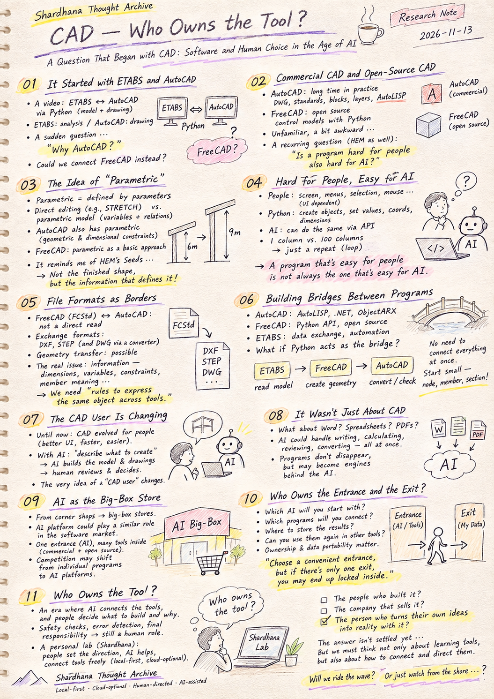
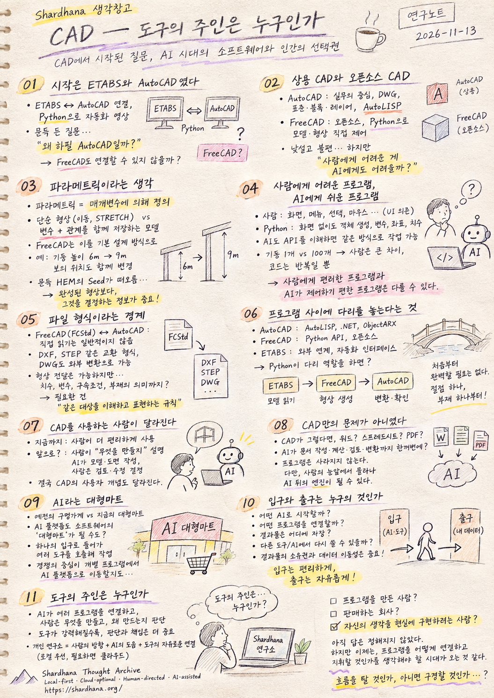

> Location: `docs/thoughts/cad.md`

# CAD — Who Owns the Tool?

## A Question That Began with CAD: Software and Human Choice in the Age of AI

(Shardhana Thought Archive)

Date: 2026-11-13

## 🎬 YouTube Video

[Watch on YouTube](https://youtu.be/o_AXIgd12ZE)

  

---

## 01. It Started with ETABS and AutoCAD

One morning I happened to watch a video.

It showed ETABS and AutoCAD linked together through Python, automating both the structural model and the drawings.

For anyone who has spent years in structural design, ETABS and AutoCAD are old acquaintances. One handles the structural analysis; the other produces the drawings.

But partway through the video, an odd question popped into my head.

Why AutoCAD, of all things?

ETABS surely didn't pick AutoCAD for any special reason. More likely, the person who made the video just used the program they knew best.

So couldn't you hook it up to FreeCAD instead?

That's how one small question got started.

---

## 02. Commercial CAD and Open-Source CAD

AutoCAD has long been at the center of design practice.

Countless drawings have been made in DWG format, and companies have built up layers of standard drawings, blocks, layer conventions, and automation on top of it.

AutoLISP in particular has been a powerful way for users to cut down on repetitive work and build exactly the functions they need.

But there's another world out there: FreeCAD.

FreeCAD is open source, and you can control a model's objects and geometry directly with Python.

For a person working by hand, it can feel unfamiliar and awkward.

I felt the same way the first time I tried FreeCAD.

Just a few days ago, while thinking about the basic direction of the HEM core, I'd asked myself a similar question.

Does a program that's hard for people have to be hard for AI, too?

Back then I was thinking about it in terms of tools for building HEM. This time, looking at the CAD market as a whole, I ran into the same question again.

---

## 03. The Idea of "Parametric"

Talking about FreeCAD brought the word *parametric* back to mind.

Parametric.

It means defined by parameters.

In everyday CAD work, you select shapes directly and move them or stretch them — using the STRETCH command to shift lines and objects around, for example.

A parametric model, on the other hand, stores the variables and relationships that determine the shape, along with the shape itself.

To be fair, AutoCAD has parametric features too, using geometric and dimensional constraints. It's not something unique to FreeCAD.

What caught my interest is that FreeCAD makes parametric modeling its basic way of designing.

Say a column is 6 m tall, with a beam connected at the top.

Change the column height to 9 m, and the beam's position can follow along, according to the constraints and connections defined in advance.

The model isn't just remembering lines.

It remembers the relationships between them — the rules that produced the shape.

That made me think of HEM's Seeds.

Of course, a parametric model and a Seed are not the same concept. One deals with design variables and constraints; the other is an attempt to deal with physical state and interaction.

Even so, they share something interesting.

In both, the information that determines the shape matters more than the finished shape itself.

---

## 04. Hard for People, Easy for AI

When people use CAD, they look at a screen.

They hunt through menus, select objects, pick coordinates, and move the mouse.

So how convenient a program feels depends heavily on its user interface.

Python, though, doesn't need to look at a screen or move a mouse.

It just creates objects, assigns values to variables, and specifies coordinates and dimensions.

An AI that understands a program's API and can write the right code can work the same way.

Drawing one column and drawing a hundred columns are very different jobs for a person — but in Python, the difference may just be the number of loop iterations.

Of course, the AI still has to understand how the program works, and the results still have to be checked for errors.

Even so, the yardstick changes.

A program that's easy for people to use and a program that's easy for AI to control don't have to be the same program.

So won't the way we judge CAD software change, too?

---

## 05. File Formats as Borders

Can a model made in FreeCAD be brought into AutoCAD?

Having AutoCAD open FreeCAD's native FCStd file directly isn't the usual way to work.

But there are data exchange formats like DXF and STEP.

And AutoCAD's own native format, DWG, can also be exported from FreeCAD with the help of an external converter.

Moving the geometry across is already possible.

The real issue is the information inside it.

Passing along a 3D shape is one thing. Passing along its dimensions, variables, constraints, and what each member actually *is* — that's a different problem.

A column might arrive as just a plain solid, or as a structural member with a material and a cross-section.

In the end, what's needed may be more than a simple file converter.

It's a set of rules that connects how different programs understand and represent the same thing.

But people can write those rules.

And now, we can hand the implementation to AI.

---

## 06. Building Bridges Between Programs

AutoCAD has development interfaces such as AutoLISP, .NET, and ObjectARX.

FreeCAD has a Python API and openly available source code.

ETABS, too, provides interfaces for exchanging data with outside programs and automating its work.

They're different programs, but each has a doorway to the outside.

So what if Python acted as the bridge between them?

Read the structural model from ETABS, generate the geometry in FreeCAD, convert it to the format you need, and check it in AutoCAD.

There's no need to connect everything perfectly from day one.

Start with one node, one member, one section.

Of course, producing real structural drawings means dealing with dimensions, annotations, details, and drafting standards as well.

But at the very least, the idea of connecting different programs is no longer some far-off fantasy.

Someone is probably building it already.

And if no one is, we can build it ourselves.

If it doesn't work, make it work.

---

## 07. The CAD User Is Changing

Until now, CAD has mostly evolved to make programs easier for people to use.

Better screens, faster commands, more convenient editing.

Users had to learn the program and build up their skill.

Even automation tools like AutoLISP were, in the end, a way for people to use CAD more efficiently.

But what happens if AI takes over a large part of the work?

Instead of drawing columns one by one, a person describes what structure needs to be built.

The AI builds the model and produces the drawings.

The person reviews the results and decides what to change.

At that point, the very idea of a "CAD user" changes.

The one typing commands becomes the AI, and the person may step into the role of directing that AI.

So what happens to the value of the user interfaces that commercial CAD has spent decades refining?

They won't disappear.

But whether they'll keep the weight they carry today is hard to say.

---

## 08. It Wasn't Just About CAD

The thought didn't stop there.

If that's true for CAD, what about Word?

Spreadsheets?

PDFs?

Until now, people opened a word processor to write documents and a spreadsheet to build calculation tables.

They used yet another program to edit or convert PDFs.

Each program developed its own screens and its own command system.

But what if you could hand writing, calculating, reviewing, and converting to an AI all at once?

The AI could call on different tools as needed and produce the result.

Along the way, the user might not even know which program actually did the work.

The programs aren't going away.

But they may step back from in front of us and become engines running behind the AI.

If so, this may not be a change in the CAD industry alone, but in the software industry as a whole.

---

## 09. AI as the Big-Box Store

The image of corner shops and big-box stores suddenly came to mind.

There was a time when you went from shop to shop to find everything you needed.

When the big-box stores arrived, people could choose from all kinds of goods in one place.

Convenience grew.

But so did the power of the companies that controlled distribution.

Could AI platforms end up playing a similar role in the software market?

Users walk in through a single entrance called AI.

Inside, they write documents, make drawings, run calculations, and analyze.

Behind the scenes, the AI picks from the commercial programs and open-source tools connected to it.

Individual software still exists, but its chances to meet users face to face may shrink.

And then the center of competition might shift from individual programs to AI platforms.

Of course, there's no guarantee that every program will end up locked into one giant platform.

A landscape where many AIs and open-source projects compete and cooperate is just as possible.

Which way it will go, no one knows yet.

But it's hard to shake the feeling that a new big-box store is opening its doors.

---

## 10. Who Owns the Entrance and the Exit?

Just because a big-box store is convenient doesn't mean you have to hand over all your choices.

The same goes for AI platforms.

Which AI will you start your work through?

Which programs will you connect?

Where will the results be stored?

And can those results be used again in another program, or with another AI?

These questions will only matter more from here on.

In particular, ownership of your work and the portability of your data need to be thought about separately.

Even if you made the file yourself, if only one program can open it, you can't really use it freely.

On the other hand, if you use open formats and standards, you have a much better chance of carrying on your work even when you switch tools.

Choose whichever entrance is convenient.

But if there's only one exit, someday you may find yourself locked inside.

In the end, what matters isn't only whether a program is commercial or open source.

It's how freely users can control their own work and their own data.

---

## 11. Who Owns the Tool?

I've worked in structural design for a long time.

Over the years I've used countless programs, and every time the program changed, I had to learn a new set of commands and a new way of working.

But now I see a different possibility.

An era where people don't need to be fluent in every program.

An era where AI connects the programs, and people decide what to build and why.

Of course, AI won't solve every problem.

Judging whether a structure is safe, spotting errors in the results, and taking final responsibility remain as important as ever.

If anything, the more powerful the tools become, the more that judgment may matter.

The reason I started thinking about Shardhana isn't far from this.

A personal lab where people set the direction, AI helps with the work, and the tools you need can be connected freely.

An environment that starts local, uses the cloud when needed, and keeps the results and the flow of work in your own hands as much as possible.

There's no need to reject the big AI platforms.

Use them as much as you like, whenever you need them.

But there's no need to hand over both the entrance and the exit of your own lab.

This morning's small question started with ETABS and AutoCAD.

And in the end, it came back to one question.

Who owns the tool?

The people who built the program?

The company that sells it?

Or the person trying to turn their own ideas into reality with it?

I'd like to lean a little more toward the last.

The answer isn't settled yet.

But it seems we're entering a time when, as much as learning programs, we need to think about how to connect them and direct them.

Will we ride the wave?

Or just watch from the shore?

Maybe that choice itself is where the new era begins.

---

Shardhana Thought Archive
Local-first · Cloud-optional · Human-directed · AI-assisted
https://shardhana.org/

This document was prepared with the assistance of Shana (GPT) and Laude (Claude).

---
 
 

# CAD — 도구의 주인은 누구인가

## CAD에서 시작된 질문, AI 시대의 소프트웨어와 인간의 선택권

(Shardhana 생각창고)

작성일: 2026-11-13

## 🎬 YouTube Video

[Watch on YouTube](https://youtu.be/IQzWZOTE1yM)

  

---

## 01. 시작은 ETABS와 AutoCAD였다

아침에 우연히 영상 하나를 보았다.

ETABS와 AutoCAD를 Python으로 연결하여 구조 모델과 도면 작업을 자동화하는 영상이었다.

구조설계를 오래 해온 사람에게 ETABS와 AutoCAD는 낯선 프로그램이 아니다. 하나는 구조해석을 담당하고, 다른 하나는 도면을 작성한다.

그런데 영상을 보다가 엉뚱한 질문이 떠올랐다.

왜 하필 AutoCAD일까?

ETABS가 AutoCAD를 특별히 선택한 것은 아닐 것이다. 영상을 만든 사람이 익숙한 프로그램을 선택했을 가능성이 크다.

그렇다면 FreeCAD를 연결해도 되는 것 아닐까?

그렇게 작은 의문 하나가 시작되었다.

---

## 02. 상용 CAD와 오픈소스 CAD

AutoCAD는 오랫동안 설계 실무의 중심에 있었다.

수많은 도면이 DWG 형식으로 작성되었고, 기업들은 그 위에 표준도면과 블록, 레이어, 자동화 기능을 쌓아왔다.

특히 AutoLISP는 사용자가 반복 작업을 줄이고 자신에게 필요한 기능을 직접 만드는 강력한 수단이었다.

하지만 FreeCAD라는 또 다른 세계가 있다.

FreeCAD는 오픈소스이며, Python으로 모델의 객체와 형상을 직접 제어할 수 있다.

사람이 직접 조작하기에는 낯설고 불편할 수도 있다.

나 역시 FreeCAD를 처음 접했을 때 사용하기 어렵다고 느꼈다.

며칠 전 HEM 코어의 기본 방향을 생각하면서도 비슷한 질문을 했었다.

사람에게 어려운 프로그램이 반드시 AI에게도 어려운 프로그램일까?

그때는 HEM을 구현할 도구의 관점에서 생각했다면, 이번에는 CAD 시장 전체를 바라보며 같은 질문을 다시 만나게 되었다.

---

## 03. 파라메트릭이라는 생각

FreeCAD를 이야기하다가 파라메트릭이라는 단어를 다시 생각하게 되었다.

파라메트릭(Parametric).

매개변수에 의해 정의된다는 뜻이다.

일반적인 CAD 작업에서는 형상을 직접 선택하고 이동하거나 늘린다. STRETCH 명령으로 선과 객체의 위치를 바꾸는 식이다.

하지만 파라메트릭 모델은 형상을 결정하는 변수와 관계를 함께 저장한다.

물론 AutoCAD에도 기하 구속과 치수 구속을 이용한 파라메트릭 기능이 있다. FreeCAD만의 특별한 기술은 아니다.

다만 FreeCAD는 파라메트릭 모델링을 기본적인 설계 방식으로 삼고 있다는 점이 흥미로웠다.

기둥의 높이가 6m이고, 그 상단에 보가 연결되어 있다고 가정하자.

기둥 높이를 9m로 변경하면, 미리 정의된 구속조건과 연결 관계에 따라 보의 위치도 함께 변경될 수 있다.

단순히 선을 기억하는 것이 아니다.

선과 선 사이의 관계, 형상을 만들어낸 규칙까지 기억한다.

문득 HEM의 Seed가 떠올랐다.

물론 파라메트릭 모델과 Seed는 같은 개념이 아니다. 하나는 설계 변수와 구속조건을 다루고, 다른 하나는 물리적 상태와 상호작용을 다루려는 구상이다.

그럼에도 둘 사이에는 흥미로운 공통점이 있었다.

완성된 형상보다 그것을 결정하는 정보가 중요하다는 점이다.

---

## 04. 사람에게 어려운 프로그램, AI에게 쉬운 프로그램

사람은 CAD를 사용할 때 화면을 본다.

메뉴를 찾고, 객체를 선택하고, 좌표를 지정하고, 마우스를 움직인다.

그래서 프로그램의 편리함은 사용자 인터페이스에 크게 좌우된다.

하지만 Python은 화면을 보면서 마우스를 움직일 필요가 없다.

객체를 생성하고, 변수에 값을 넣고, 좌표와 치수를 지정하면 된다.

AI 역시 프로그램의 API를 이해하고 적절한 코드를 작성할 수 있다면 같은 방식으로 작업할 수 있다.

기둥 하나를 만드는 작업과 기둥 백 개를 만드는 작업이 사람에게는 상당히 다르지만, Python에서는 반복 횟수의 차이일 수 있다.

물론 AI도 프로그램의 구조를 이해해야 하고, 오류를 검증해야 한다.

그럼에도 평가 기준이 달라진다.

사람에게 사용하기 편리한 프로그램과 AI가 제어하기 편리한 프로그램은 반드시 같을 필요가 없다.

그렇다면 앞으로 CAD를 평가하는 기준도 달라지지 않을까?

---

## 05. 파일 형식이라는 경계

FreeCAD에서 작성한 모델을 AutoCAD로 가져갈 수 있을까?

FreeCAD의 원본 파일인 FCStd를 AutoCAD가 직접 읽는 것은 일반적인 작업 방식이 아니다.

하지만 DXF와 STEP 같은 데이터 교환 형식이 있다.

AutoCAD의 원본 형식인 DWG 역시 FreeCAD에서 외부 변환 도구를 이용해 내보내는 방법이 있다.

형상을 전달하는 것은 이미 가능한 일이다.

문제는 그 안에 담긴 정보다.

3차원 형상을 전달하는 것과 치수, 변수, 구속조건, 부재의 의미까지 전달하는 것은 서로 다른 문제다.

기둥이라는 객체가 단순한 솔리드로 전달될 수도 있고, 재료와 단면을 가진 구조 부재로 전달될 수도 있다.

결국 필요한 것은 단순한 파일 변환기만이 아닐 수 있다.

서로 다른 프로그램이 같은 대상을 어떻게 이해하고 표현하는지 연결하는 규칙이 필요하다.

하지만 그 규칙 역시 사람이 만들 수 있다.

그리고 이제는 AI에게 그 구현을 맡길 수도 있다.

---

## 06. 프로그램 사이에 다리를 놓는다는 것

AutoCAD에는 AutoLISP, .NET, ObjectARX 같은 개발 인터페이스가 있다.

FreeCAD에는 Python API와 공개된 소스코드가 있다.

ETABS 역시 외부 프로그램과 데이터를 교환하고 자동화할 수 있는 인터페이스를 제공한다.

서로 다른 프로그램이지만 외부와 연결할 수 있는 통로가 존재한다.

그렇다면 Python이 그 사이에서 다리 역할을 하면 어떨까?

ETABS에서 구조 모델을 읽고, FreeCAD에서 형상을 생성하고, 필요한 형식으로 변환하여 AutoCAD에서 확인한다.

처음부터 모든 기능을 완벽하게 연결할 필요는 없다.

절점 하나, 부재 하나, 단면 하나부터 연결하면 된다.

물론 실제 구조도면을 작성하려면 치수, 주석, 상세, 도면 표준까지 해결해야 한다.

그러나 적어도 서로 다른 프로그램을 연결한다는 생각 자체는 더 이상 특별한 상상이 아니다.

누군가는 이미 만들고 있을 것이다.

누군가 만들지 않았다면, 직접 만들 수도 있다.

안 되면 되게 하라.

---

## 07. CAD를 사용하는 사람이 달라진다

지금까지 CAD의 발전은 주로 사람이 프로그램을 더 편리하게 사용하도록 만드는 방향이었다.

더 좋은 화면, 더 빠른 명령, 더 편리한 편집 기능.

사용자는 프로그램을 배우고 숙련도를 높여야 했다.

AutoLISP 같은 자동화 도구도 결국 사람이 CAD를 더 효율적으로 사용하기 위한 수단이었다.

그런데 AI가 작업의 상당 부분을 수행한다면 어떻게 될까?

사람은 기둥을 하나씩 그리는 대신, 어떤 구조물을 만들어야 하는지 설명한다.

AI는 모델을 만들고 도면을 작성한다.

사람은 결과를 검토하고 수정 방향을 결정한다.

이렇게 되면 CAD의 사용자라는 개념 자체가 달라진다.

직접 명령을 입력하는 사용자는 AI가 되고, 사람은 그 AI에게 작업을 지시하는 위치에 설 수도 있다.

그렇다면 상용 CAD가 오랫동안 발전시켜 온 사용자 인터페이스의 가치는 어떻게 변할까?

사라지지는 않을 것이다.

하지만 지금과 같은 비중을 계속 유지할지는 알 수 없다.

---

## 08. CAD만의 문제가 아니었다

생각은 여기서 멈추지 않았다.

CAD가 그렇다면 워드는 어떨까?

스프레드시트는?

PDF는?

지금까지 사람은 문서를 작성하기 위해 워드프로세서를 열고, 계산표를 만들기 위해 스프레드시트를 열었다.

PDF를 수정하거나 변환하기 위해 또 다른 프로그램을 사용했다.

각 프로그램은 자신만의 화면과 명령 체계를 발전시켰다.

그런데 AI에게 문서 작성, 계산, 검토, 변환을 한꺼번에 맡길 수 있다면?

AI는 필요에 따라 여러 도구를 호출하고 결과물을 만들어낼 수 있다.

그 과정에서 사용자는 어떤 프로그램이 실제로 작업을 수행했는지조차 모를 수 있다.

프로그램은 사라지는 것이 아니다.

다만 사람의 눈앞에서 물러나, AI 뒤에서 작동하는 엔진이 될 가능성이 있다.

그렇다면 이것은 CAD 산업의 변화가 아니라 소프트웨어 산업 전체의 변화일지도 모른다.

---

## 09. AI라는 대형마트

문득 동네 구멍가게와 대형마트가 떠올랐다.

예전에는 필요한 물건을 사기 위해 여러 가게를 찾아다녔다.

대형마트가 등장하면서 사람들은 하나의 장소에서 다양한 물건을 선택할 수 있게 되었다.

편리함은 커졌다.

하지만 동시에 유통망을 장악한 기업의 영향력도 커졌다.

AI 플랫폼이 소프트웨어 시장에서 비슷한 역할을 하게 될 수도 있지 않을까?

사용자는 AI라는 하나의 입구로 들어간다.

그 안에서 문서를 작성하고, 도면을 만들고, 계산하고, 분석한다.

AI는 뒤에 연결된 상용 프로그램과 오픈소스 도구를 선택하여 작업한다.

개별 소프트웨어는 여전히 존재하지만, 사용자와 직접 만나는 기회는 줄어들 수 있다.

그렇게 되면 경쟁의 중심은 개별 프로그램에서 AI 플랫폼으로 이동할지도 모른다.

물론 모든 프로그램이 하나의 거대한 플랫폼에 종속된다는 보장은 없다.

여러 AI와 오픈소스가 경쟁하고 협력하는 구조도 가능하다.

아직 어느 쪽으로 흘러갈지는 알 수 없다.

다만 새로운 대형마트가 등장하고 있다는 느낌은 지울 수 없다.

---

## 10. 입구와 출구는 누구의 것인가

대형마트가 편리하다고 해서 모든 선택권을 넘겨줄 필요는 없다.

AI 플랫폼도 마찬가지다.

어떤 AI를 통해 작업을 시작할 것인가?

어떤 프로그램을 연결할 것인가?

만들어진 결과물은 어디에 저장할 것인가?

그리고 그 결과물을 다른 프로그램이나 다른 AI에서 다시 사용할 수 있는가?

이 질문들은 앞으로 더욱 중요해질 것이다.

특히 결과물의 소유권과 데이터의 이동 가능성은 구분해서 생각해야 한다.

내가 만든 파일이라고 해도 특정 프로그램에서만 열 수 있다면 자유롭게 활용하기 어렵다.

반대로 공개된 형식과 표준을 사용한다면 도구를 바꾸더라도 작업을 이어갈 가능성이 커진다.

입구는 편리한 곳을 선택하면 된다.

하지만 출구가 하나뿐이라면 언젠가는 그 안에 갇힐 수도 있다.

결국 중요한 것은 프로그램이 상용인지 오픈소스인지에만 있지 않다.

사용자가 자신의 작업과 데이터를 얼마나 자유롭게 통제할 수 있는가에 있다.

---

## 11. 도구의 주인은 누구인가

나는 오랫동안 구조설계를 해왔다.

그동안 수많은 프로그램을 사용했고, 프로그램이 바뀔 때마다 새로운 명령과 사용법을 배워야 했다.

그런데 이제는 다른 가능성이 보인다.

사람이 모든 프로그램을 능숙하게 조작할 필요가 없는 시대.

AI가 여러 프로그램을 연결하고, 사람은 무엇을 만들고 왜 만들어야 하는지 판단하는 시대.

물론 AI가 모든 문제를 해결해 주지는 않는다.

구조물의 안전성을 판단하고, 결과의 오류를 발견하고, 최종 책임을 지는 일은 여전히 중요하다.

오히려 도구가 강력해질수록 그 판단은 더욱 중요해질 수 있다.

샤드하나를 생각하게 된 이유도 이와 멀리 떨어져 있지 않다.

사람이 방향을 정하고, AI가 작업을 돕고, 필요한 도구를 자유롭게 연결하는 개인 연구소.

로컬에서 시작하되 필요하면 클라우드를 이용하고, 가능한 한 결과물과 작업의 흐름을 스스로 관리하는 환경.

거대한 AI 플랫폼을 거부할 필요는 없다.

필요하다면 얼마든지 이용하면 된다.

다만 내 연구소의 입구와 출구까지 모두 맡길 필요는 없을 것이다.

오늘 아침의 작은 질문은 ETABS와 AutoCAD에서 시작되었다.

그리고 결국 하나의 질문으로 돌아왔다.

도구의 주인은 누구인가?

프로그램을 만든 사람인가.

프로그램을 판매하는 회사인가.

아니면 그 프로그램으로 자신의 생각을 현실에 구현하려는 사람인가.

나는 마지막에 조금 더 무게를 두고 싶다.

아직 답은 정해지지 않았다.

하지만 이제는 프로그램을 배우는 것만큼, 프로그램들을 어떻게 연결하고 지휘할 것인가를 생각해야 할 시대가 오는 것 같다.

흐름을 탈 것인가.

아니면 구경할 것인가.

어쩌면 그 선택부터가 새로운 시대의 시작인지도 모른다.

---

Shardhana Thought Archive
Local-first · Cloud-optional · Human-directed · AI-assisted
https://shardhana.org/

이 문서는 샤나(GPT)와 로드(Claude)의 도움을 받아 작성되었습니다.
