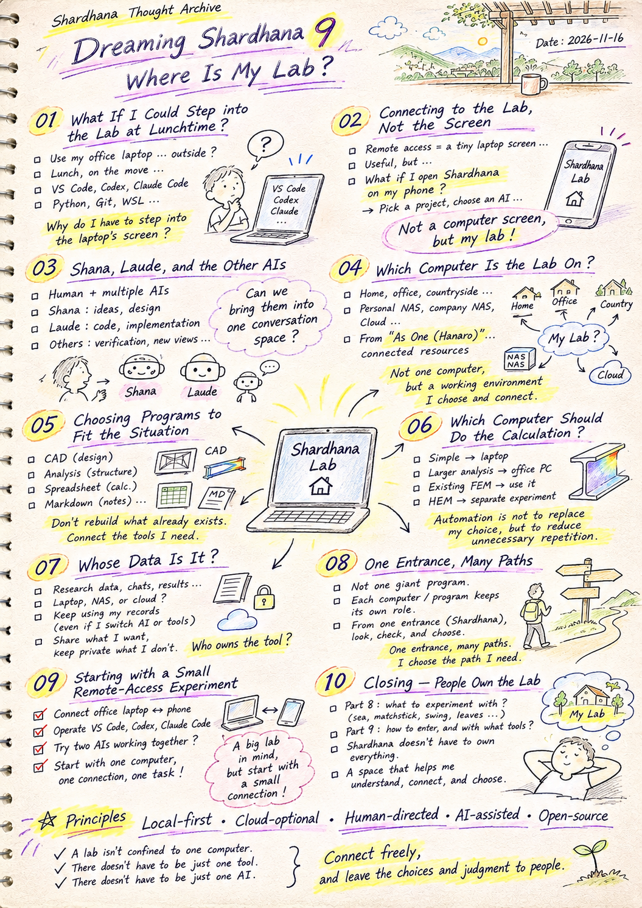
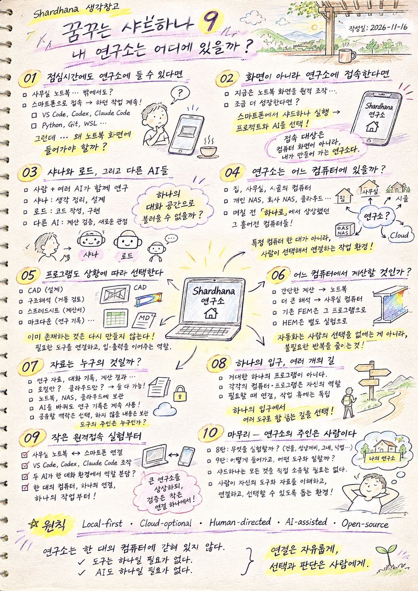

> Location: `docs/thoughts/dreaming-shardhana9-notes.md`

# Dreaming Shardhana 9

## Where Is My Lab?

(Shardhana Thought Archive)

Date: 2026-11-16

  

---

## 01. What If I Could Step into the Lab at Lunchtime?

It started with a very practical question.

Could I use my office laptop from outside the office? While grabbing lunch or on the move, could I connect from my phone and pick up the development work I'd left off?

The laptop already has VS Code, Codex, and Claude Code installed. I use Python and Git on it, and there's even a WSL setup I haven't touched in a while.

I didn't want to build a new development environment. I just wanted to use the one I already had, from somewhere else.

A remote desktop app seemed like it would do the trick. Open the laptop's screen on my phone, run my usual programs, and tell the AI what to code.

But the more I thought about it, the stranger it seemed.

Why do I have to step into the laptop's screen just to use the laptop?

---

## 02. Connecting to the Lab, Not the Screen

Right now, I open VS Code on the laptop and run Codex and Claude Code separately. When I need to, I open a terminal to run Python or manage my work with Git.

Even with remote access from a phone, it still comes down to operating the laptop through a tiny screen.

Of course, for now that alone is genuinely useful. I can keep working without heading back to the office.

But what if Shardhana grew a little more?

Couldn't I just open Shardhana on my phone and pick the project and the AI I need from inside it?

Instead of dragging the laptop's screen over, Shardhana would connect me to the work itself.

What I want to connect to isn't a computer screen — it's the lab I'm building.

---

## 03. Shana, Laude, and the Other AIs

For a long time, I've imagined people and multiple AIs working together in the Shardhana lab.

A person sets the research direction. Shana helps organize ideas and shape the design. Laude writes the code and handles implementation. When needed, another AI checks the calculations or offers a fresh perspective.

But today, each AI lives in a different environment.

ChatGPT has its own chat window, Codex has its own development environment, and Claude Code runs in its own space too. Local LLMs like Ollama connect in yet another way.

So couldn't Shardhana bring them all into a single conversation space?

I ask a question, Shana offers an opinion, and Laude looks at how to implement it. A local LLM joins in when useful, and an AI assigned to verification checks the results.

Of course, just giving them names doesn't mean they can talk to each other. You need ways to connect each AI, authentication, shared conversation history, clear roles, and execution permissions.

And being in the same chat window doesn't mean they all share the same memory.

Still, the goal is clear.

Not a person wandering from program to program looking for AIs, but the AIs you need joining the person's lab.

---

## 04. Which Computer Is the Lab On?

At first, I was only thinking about the office laptop.

But there's a computer at home and one at the office. I could use the one in the countryside, too. There's a personal NAS and a company NAS, and the cloud when I need it.

These are the same scattered computers and storage devices I imagined a few days ago in "As One (Hanaro)." Back then, I was thinking about how to connect them. This time, I found myself wondering how a person would actually choose and use that connected environment.

So where on earth should the Shardhana lab live?

It doesn't seem like everything has to be gathered onto one computer.

The office computer could run structural analysis, and the home computer could handle documents. The NAS could hold research data, and the laptop could carry on with development.

Some days I might use a local LLM; when I need a bigger model, I might choose a cloud AI.

Of course, not every device is always on or always connected. Access rights, network conditions, and installed software all differ.

So it would be nice if Shardhana could check what resources are available and help the person choose among them.

The lab may not be one particular computer, but a working environment that a person chooses and connects.

---

## 05. Choosing Programs to Fit the Situation

Connecting computers and AIs alone doesn't make a lab.

Real work takes many programs.

Designing a building calls for CAD; studying structural behavior calls for analysis software. Spreadsheets are handy for calculation sheets, and Markdown is great for keeping research notes.

Some programs run on Windows; others are happier on Linux. Some only work locally; others need to connect to outside services.

So does Shardhana have to build every feature itself?

I asked a similar question in Part 8.

Don't rebuild what already exists.

Leave each program to do what it does well. Shardhana can connect the programs you need and pass inputs and results between them.

Of course, every program has its own data formats and ways of running, so connecting them won't be easy.

Still, what matters to a person isn't the name of the program, but the work they're trying to do.

Which tool to use is the person's choice, based on the purpose and the situation.

---

## 06. Which Computer Should Do the Calculation?

Say I connect to Shardhana from my phone to check a single steel beam.

A simple calculation could run on the laptop. If I need a bigger analysis, I could choose the office computer instead.

Where existing FEM software can do the job, I use it. The parts I want to explore with HEM, I approach as separate experiments.

The results are stored wherever the user chooses.

Shardhana doesn't need to decide everything automatically here.

The user can choose directly, or Shardhana can explain the available resources and likely constraints and suggest a few options.

Familiar tasks could be automated, while important ones are set up for a person to check directly.

That said, remote computation comes with plenty of problems to solve: execution permissions, data transfer, connections dropping mid-calculation, and keeping results consistent across different computers.

That's why it's more realistic to start with one laptop and verify things one at a time, rather than trying to connect everything from the start.

The point of automation isn't to take away people's choices, but to cut out needless repetition.

---

## 07. Whose Data Is It?

Once you start connecting computers, AIs, and programs, another question comes up.

Where should research data, conversation logs, and calculation results live?

Just because a cloud service is convenient doesn't mean you have to hand it all your data. Then again, there's no reason to insist on local machines only and shut out outside services entirely.

Some data can live on the laptop, some on the NAS, and some in the cloud.

What matters is that the user knows where it is and who can access it — and gets to choose.

Even if I switch AIs or replace a program, I'd like to keep using my research records.

I don't want conversation history locked inside one AI's chat window, either. I should be able to choose which context to share with another AI, and keep back what I don't want to share.

Of course, that takes careful design around data formats, syncing, and security.

A few days ago, in the Thought Archive piece on CAD, I asked a similar question.

Who owns the tool?

That question still matters in Shardhana.

---

## 08. One Entrance, Many Paths

I don't want Shardhana to become one giant program.

Nor am I trying to gather every computer onto one server, or merge every AI into a single model.

Each computer and program keeps its own role. They connect when needed, and go back to standing on their own when the work is done.

From one entrance called Shardhana, a person looks over their research environment.

Which computers are connected, which AIs are available, which programs are ready.

And then they choose the work to do.

Maybe someday we'll work without thinking much about where the computers are. But if you want to know what's running where, you should always be able to check.

One entrance doesn't mean owning everything. It means letting people choose the paths that lead to many tools.

---

## 09. Starting with a Small Remote-Access Experiment

Talking it through, the dream has gotten pretty big.

But what needs doing right now is still simple.

Connect the office laptop and my phone.

Check whether VS Code, Codex, and Claude Code — the tools I use on the laptop — can be operated from my phone.

After that, I could test whether two AIs can split up roles and work together in one conversation space.

If that works, I'll slowly start to see which features Shardhana needs to provide itself, and which can be left to existing tools.

There's no need to connect the home, office, and countryside computers all at once. No reason to fold in the NAS and the cloud in one go, either.

Start with one computer, one connection, one task.

Just like in Part 8, where we said we'd begin physics experiments with a single matchstick and a single steel beam.

Imagine a big lab — but start verifying with one small connection.

---

## 10. Closing — People Own the Lab

In Part 8, I imagined what I'd like to experiment with inside Shardhana.

A space for dropping a building into the sea, knocking down a matchstick tower, calculating the fatigue life of a swing, and exploring why leaves fall.

In Part 9, I thought about how to get into that space, and which tools to work alongside.

Whether at home, at the office, in the countryside, or on the road.

What if, with just a phone, you could step into your own lab and choose the computers, AIs, and programs you need?

Shardhana doesn't have to compute everything itself. It doesn't have to own every AI. It doesn't have to gather every piece of data in one place.

I just hope it can be an environment that helps people understand, connect, and choose their own tools and data.

The principles we set out point in that same direction.

Local-first · Cloud-optional · Human-directed · AI-assisted · Open-source

Start local, and use the cloud by choice. AI helps people, and people make the final call. And as far as possible, aim for an open environment that anyone can look into and build on.

Shardhana is still a small program, and most of what I imagined today hasn't been built yet.

But recording the dream is something I can do right now.

Someday I may read this again while opening Shardhana on my phone, actually connecting several computers and AIs.

Then I'll be able to see how close today's imagination came to reality.

---

Shardhana aims to be a personal lab that connects a person's computers, AIs, programs, and data as needed, and helps them choose their own research environment.

---

A lab isn't confined to a single computer.

There doesn't have to be just one tool.

There doesn't have to be just one AI.

Connect freely,

and leave the choices and judgment to people.

---

Shardhana Thought Archive
Local-first · Cloud-optional · Human-directed · AI-assisted · Open-source
https://shardhana.org/

This document was prepared with the assistance of Shana (GPT) and Laude (Claude).

---
 
 

# 꿈꾸는 샤드하나9

## 내 연구소는 어디에 있을까?

(Shardhana 생각창고)

작성일: 2026-11-16

  

---

## 01. 점심시간에도 연구소에 들어갈 수 있다면

시작은 아주 현실적인 질문이었다.

사무실에 있는 노트북을 밖에서도 사용할 수 있을까? 점심을 먹거나 이동하는 동안 스마트폰으로 접속해서, 하던 개발 작업을 계속할 수 없을까?

노트북에는 이미 VS Code와 Codex, Claude Code가 설치되어 있다. Python과 Git도 사용하고 있고, 한동안 사용하지 않은 WSL도 남아 있다.

새로운 개발 환경을 만들고 싶은 게 아니었다. 이미 사용하고 있는 환경을 다른 장소에서도 그대로 이용하고 싶었다.

원격접속 프로그램을 이용하면 가능할 것 같았다. 스마트폰으로 노트북 화면을 열고, 기존 프로그램을 실행하고, AI에게 코딩을 지시하는 것이다.

그런데 생각하다 보니 조금 이상했다.

왜 나는 노트북을 사용하기 위해 노트북 화면에 들어가야 할까?

---

## 02. 화면이 아니라 연구소에 접속한다면

지금은 노트북에서 VS Code를 열고, Codex와 Claude Code를 각각 실행한다. 필요하면 터미널을 열고 Python을 실행하거나 Git으로 작업 내용을 관리한다.

스마트폰에서 원격접속을 하더라도 결국 작은 화면으로 노트북을 조작하는 방식이다.

물론 당장은 그것만으로도 충분히 유용하다. 사무실에 돌아가지 않고도 개발 작업을 이어갈 수 있으니까.

하지만 샤드하나가 조금 더 성장한다면?

스마트폰에서 샤드하나를 실행하고, 그 안에서 필요한 프로젝트와 AI를 선택하면 되지 않을까?

노트북 화면을 그대로 가져오는 대신, 샤드하나가 필요한 작업을 연결해 주는 것이다.

접속하려는 대상은 컴퓨터 화면이 아니라, 내가 만들어 가는 연구소다.

---

## 03. 샤나와 로드, 그리고 다른 AI들

샤드하나 연구소에서는 사람과 여러 AI가 함께 일하는 모습을 오래전부터 상상해 왔다.

사람이 연구 방향을 정하고, 샤나는 생각을 정리하고 설계를 돕는다. 로드는 코드를 작성하고 구현을 맡는다. 필요하면 다른 AI가 계산을 검증하거나 새로운 관점에서 의견을 낸다.

그런데 지금은 각 AI를 사용하는 환경이 서로 다르다.

ChatGPT에는 ChatGPT의 대화창이 있고, Codex에는 개발 환경이 있다. Claude Code도 별도의 실행 환경을 사용한다. 올라마 같은 로컬 LLM은 또 다른 방식으로 연결된다.

그렇다면 샤드하나 안에서 이들을 하나의 대화 공간으로 불러올 수 없을까?

내가 질문하면 샤나가 의견을 내고, 로드가 구현 방법을 검토한다. 필요하면 로컬 LLM이 참여하고, 검증 역할을 맡은 AI가 결과를 확인한다.

물론 이름만 붙인다고 서로 대화할 수 있는 것은 아니다. 각 AI를 연결하는 방법과 인증, 대화 기록의 공유, 역할 구분, 실행 권한을 마련해야 한다.

같은 대화창에 있다고 해서 모두 같은 기억을 갖는 것도 아니다.

그래도 목표는 분명하다.

사람이 AI를 찾아 여러 프로그램을 돌아다니는 것이 아니라, 필요한 AI들이 사람의 연구소에 참여하는 환경.

---

## 04. 연구소는 어느 컴퓨터에 있을까?

처음에는 사무실 노트북 한 대만 생각했다.

그런데 집에도 컴퓨터가 있고, 사무실에도 컴퓨터가 있다. 시골에 있는 컴퓨터를 사용할 수도 있다. 개인 NAS와 회사 NAS가 있고, 필요하면 클라우드도 사용할 수 있다.

며칠 전 「하나로」에서 상상했던, 서로 다른 장소에 흩어져 있는 컴퓨터와 저장소들이다. 그때는 이들을 어떻게 연결할지 생각했다면, 이번에는 그 연결된 환경을 사람이 어떻게 선택하고 사용할지 궁금해졌다.

그렇다면 샤드하나 연구소는 도대체 어디에 있어야 할까?

반드시 한 대의 컴퓨터에 모든 것을 모을 필요는 없을 것 같다.

사무실 컴퓨터에서는 구조해석을 실행하고, 집 컴퓨터에서는 문서를 정리할 수 있다. NAS에는 연구 자료를 보관하고, 노트북에서는 개발 작업을 계속할 수 있다.

어떤 날은 로컬 LLM을 사용하고, 더 큰 모델이 필요할 때는 클라우드 AI를 선택할 수도 있다.

물론 모든 장치가 항상 켜져 있거나 연결되어 있는 것은 아니다. 접근 권한과 네트워크 상태, 프로그램 설치 여부도 서로 다르다.

그래서 샤드하나는 사용 가능한 자원을 확인하고, 사람이 그중에서 선택할 수 있도록 도와주면 좋겠다.

연구소는 특정 컴퓨터 한 대가 아니라, 사람이 선택해서 연결하는 작업 환경일 수 있다.

---

## 05. 프로그램도 상황에 따라 선택한다

컴퓨터와 AI만 연결한다고 연구소가 완성되는 것은 아니다.

실제 작업에는 여러 프로그램이 필요하다.

건물을 설계할 때는 CAD가 필요하고, 구조 거동을 살펴볼 때는 구조해석 프로그램이 필요하다. 계산서를 만들 때는 스프레드시트가 편리하고, 연구 내용을 기록할 때는 마크다운이 좋다.

어떤 프로그램은 Windows에서 실행되고, 어떤 프로그램은 Linux 환경이 편리하다. 로컬에서만 사용할 수 있는 프로그램도 있고, 외부 서비스와 연결해야 하는 프로그램도 있다.

그렇다면 샤드하나가 모든 기능을 직접 만들어야 할까?

8탄에서 이미 비슷한 질문을 했다.

이미 존재하는 것은 다시 만들지 않는다.

기존 프로그램이 잘하는 일은 그 프로그램에 맡기면 된다. 샤드하나는 필요한 프로그램을 연결하고, 입력과 결과를 이어 주는 역할을 할 수 있다.

물론 프로그램마다 데이터 형식과 실행 방식이 달라서 연결이 쉽지는 않을 것이다.

그래도 사람에게 중요한 것은 프로그램의 이름보다 자신이 하려는 작업이다.

어떤 도구를 사용할지는 작업의 목적과 상황에 따라 사람이 선택한다.

---

## 06. 어느 컴퓨터에서 계산할 것인가?

예를 들어 스마트폰으로 샤드하나에 접속해 철골보 하나를 검토한다고 생각해 보자.

간단한 계산은 노트북에서 실행할 수 있다. 더 큰 해석이 필요하면 사무실 컴퓨터를 선택할 수도 있다.

기존 FEM 프로그램으로 계산할 수 있는 부분은 그 프로그램을 사용하고, HEM에서 연구하고 싶은 부분은 별도의 실험으로 진행한다.

계산 결과는 사용자가 선택한 저장소에 보관한다.

여기서 샤드하나가 모든 것을 자동으로 결정할 필요는 없다.

사용자가 직접 선택할 수도 있고, 샤드하나가 사용 가능한 자원과 예상되는 제약을 설명하고 몇 가지 방법을 제안할 수도 있다.

익숙해진 작업은 자동화하고, 중요한 작업은 사람이 직접 확인하도록 설정할 수도 있을 것이다.

다만 원격 계산에는 해결해야 할 문제가 많다. 프로그램의 실행 권한, 데이터 전송, 계산 중 연결이 끊어지는 상황, 서로 다른 컴퓨터의 작업 결과를 일치시키는 문제까지.

그렇기 때문에 처음부터 모든 것을 연결하려고 하기보다, 노트북 한 대에서 시작해 하나씩 검증하는 편이 현실적이다.

자동화의 목적은 사람의 선택을 없애는 것이 아니라, 불필요한 반복을 줄이는 것이다.

---

## 07. 자료는 누구의 것일까?

여러 컴퓨터와 AI, 프로그램을 연결하다 보면 또 다른 질문이 생긴다.

연구 자료와 대화 기록, 계산 결과는 어디에 남아야 할까?

클라우드 서비스가 편리하다고 해서 모든 자료를 그곳에 맡겨야 할 필요는 없다. 반대로 로컬 컴퓨터만 고집해서 외부 서비스를 전혀 사용하지 못할 이유도 없다.

어떤 자료는 노트북에, 어떤 자료는 NAS에, 어떤 자료는 클라우드에 보관할 수 있다.

중요한 것은 사용자가 그 위치와 접근 권한을 알고 선택할 수 있어야 한다는 점이다.

AI를 바꾸거나 프로그램을 교체하더라도 자신의 연구 기록을 계속 사용할 수 있으면 좋겠다.

대화 기록 역시 특정 AI의 대화창 안에만 갇혀 있지 않았으면 한다. 필요한 맥락을 선택해 다른 AI와 공유하고, 공유하지 않을 내용은 남겨둘 수 있어야 한다.

물론 이를 위해서는 데이터 형식과 동기화, 보안에 대한 설계가 필요하다.

며칠 전 CAD에 관한 생각창고에서도 비슷한 질문을 던졌다.

도구의 주인은 누구인가?

샤드하나에서도 그 질문은 여전히 중요하다.

---

## 08. 하나의 입구, 여러 개의 길

샤드하나를 하나의 거대한 프로그램으로 만들고 싶은 것은 아니다.

모든 컴퓨터를 하나의 서버에 모으거나, 모든 AI를 하나의 모델로 통합하려는 것도 아니다.

각각의 컴퓨터와 프로그램은 자신의 역할을 유지한다. 필요한 순간에 연결되고, 작업이 끝나면 다시 독립적으로 존재할 수 있다.

사람은 샤드하나라는 하나의 입구에서 자신의 연구 환경을 살펴본다.

어떤 컴퓨터가 연결되어 있는지, 어떤 AI를 사용할 수 있는지, 어떤 프로그램이 준비되어 있는지 확인한다.

그리고 필요한 작업을 선택한다.

어쩌면 미래에는 컴퓨터의 위치를 크게 의식하지 않고 작업하게 될지도 모른다. 하지만 어디에서 무엇이 실행되는지 알고 싶다면 언제든 확인할 수 있어야 한다.

하나의 입구가 모든 것을 소유하는 것은 아니다. 여러 도구로 향하는 길을 사람이 선택할 수 있게 하는 것이다.

---

## 09. 작은 원격접속 실험부터

이렇게 이야기하다 보니 꿈이 꽤 커졌다.

하지만 지금 당장 해야 할 일은 여전히 단순하다.

사무실 노트북과 스마트폰을 연결해 보는 것이다.

노트북에서 사용하던 VS Code와 Codex, Claude Code를 모바일에서도 조작할 수 있는지 확인한다.

그다음에는 두 AI가 하나의 대화 환경에서 역할을 나누어 작업할 수 있는지 실험해 볼 수 있을 것이다.

여기까지 성공한다면 샤드하나가 직접 제공해야 할 기능과 기존 도구에 맡겨도 되는 기능이 조금씩 구분될 것 같다.

처음부터 집과 사무실, 시골의 컴퓨터를 모두 연결할 필요는 없다. NAS와 클라우드까지 한꺼번에 통합할 이유도 없다.

한 대의 컴퓨터, 하나의 연결, 하나의 작업부터 시작하면 된다.

8탄에서 성냥개비 하나와 철골보 하나로 물리 실험을 시작하자고 했던 것처럼.

큰 연구소를 상상하되, 검증은 작은 연결 하나에서 시작한다.

---

## 10. 마무리 — 연구소의 주인은 사람이다

8탄에서는 샤드하나 안에서 무엇을 실험하고 싶은지 상상했다.

건물을 바닷속에 넣어보고, 성냥개비 탑을 무너뜨리고, 그네의 피로수명을 계산하고, 낙엽이 떨어지는 이유를 탐험하는 공간.

9탄에서는 그 공간에 어떻게 들어가고, 어떤 도구와 함께 일할 것인지 생각해 보았다.

집에서든, 사무실에서든, 시골에서든, 여행 중이든.

스마트폰 하나로 자신의 연구소에 들어가 필요한 컴퓨터와 AI, 프로그램을 선택할 수 있다면 어떨까?

샤드하나가 모든 것을 직접 계산할 필요는 없다. 모든 AI를 소유할 필요도 없다. 모든 자료를 한곳에 모을 필요도 없다.

다만 사람이 자신의 도구와 자료를 이해하고, 연결하고, 선택할 수 있도록 돕는 환경이면 좋겠다.

우리가 정해 두었던 원칙도 결국 그 방향을 가리킨다.

Local-first · Cloud-optional · Human-directed · AI-assisted · Open-source

로컬에서 시작하고, 클라우드는 선택한다. AI는 사람을 돕고, 최종 판단은 사람이 한다. 그리고 가능한 한 누구나 살펴보고 발전시킬 수 있는 열린 환경을 지향한다.

아직 샤드하나는 작은 프로그램이고, 오늘 상상한 기능들은 대부분 구현되지 않았다.

하지만 꿈을 기록하는 일은 지금도 할 수 있다.

언젠가 이 글을 다시 읽으며, 스마트폰에서 샤드하나를 열고 실제로 여러 컴퓨터와 AI를 연결해 보고 있을지도 모른다.

그때는 오늘의 상상이 얼마나 현실에 가까워졌는지 확인할 수 있을 것이다.

---

샤드하나는 사람의 컴퓨터와 AI, 프로그램과 자료를 필요에 따라 연결하고, 자신의 연구 환경을 스스로 선택할 수 있도록 돕는 개인 연구소를 지향한다.

---

연구소는 한 대의 컴퓨터에 갇혀 있지 않다.

도구는 하나일 필요가 없다.

AI도 하나일 필요가 없다.

연결은 자유롭게,

선택과 판단은 사람에게.

---

Shardhana Thought Archive
Local-first · Cloud-optional · Human-directed · AI-assisted · Open-source
https://shardhana.org/

이 문서는 샤나(GPT)와 로드(Claude)의 도움을 받아 작성되었습니다.
