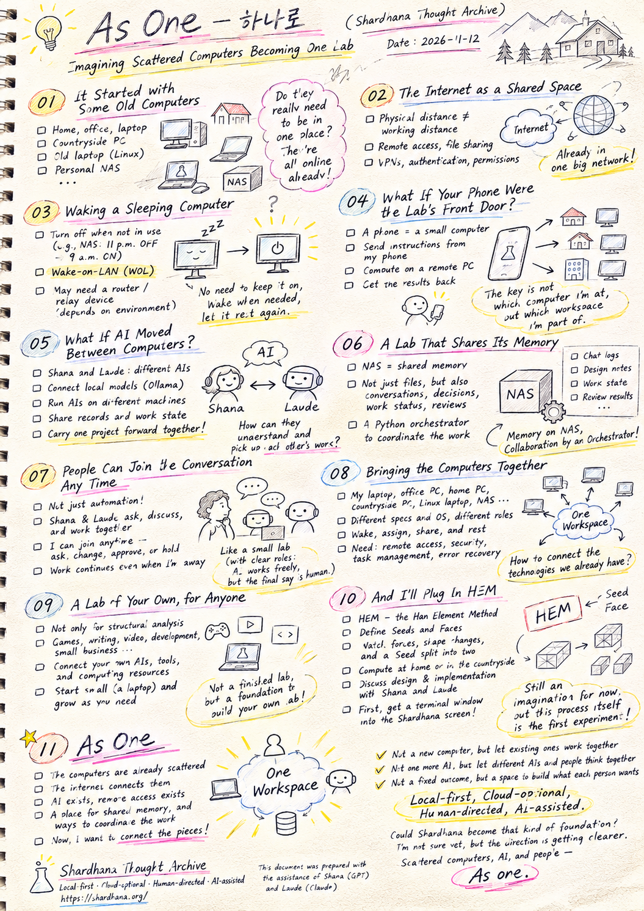
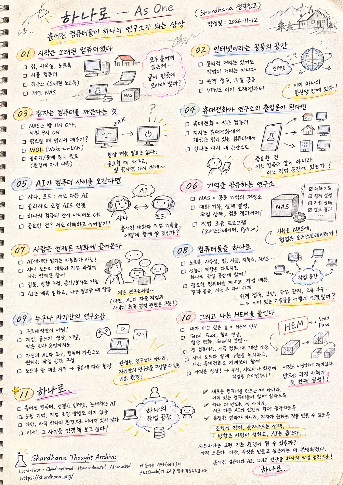

> Location: `docs/thoughts/hanaro.md`

# As One — 하나로

## Imagining Scattered Computers Becoming One Lab

(Shardhana Thought Archive)

Date: 2026-11-12

## 🎬 YouTube Video

[Watch on YouTube](https://youtu.be/AcRABGvKxOQ)

  

---

## 01. It Started with Some Old Computers

There's a computer at home.

There's one at the office, too, and the laptop I carry around. There's another computer out at my place in the countryside, and an old laptop I even put Linux on.

And there's a personal NAS.

Some of them I use every day, some I switch on now and then, and some have been asleep for a long time.

I didn't go out and buy any of this. They're just computers that piled up over the years, one by one, now scattered across different places.

Then, out of nowhere, a strange thought occurred to me.

Do these computers really need to be in one place?

They're all connected to the internet already.

---

## 02. The Internet as a Shared Space

There's real physical distance between my home computer and the one in the countryside.

But on the internet, physical distance doesn't have to mean working distance.

Connecting to your home computer from your phone, checking on the countryside machine from the office, moving files between places — we already live in a time where all of that is possible.

VPNs and remote access have been around for a long time.

Of course, being online doesn't mean every device can instantly talk to every other one. You still need authentication, permissions, and network setup.

But the key fact doesn't change.

These computers are already inside one enormous network.

We just haven't decided how to connect them to each other yet.

---

## 03. Waking a Sleeping Computer

It's natural to turn computers off when you're not using them.

Even my NAS is set to shut down at 11 p.m. and start back up at 9 a.m.

But what if you could wake a faraway computer at the moment you need it?

There's a technology called Wake-on-LAN, or WOL for short.

A computer that supports it can receive a power-on signal over the network.

Of course, you may need a router or a separate relay device that can actually deliver the signal to a machine that's switched off. Whether it works at all depends on the hardware and the network.

Still, the idea is intriguing.

Computers don't have to stay on all the time.

You wake them when you need them, and let them rest again when the work is done.

Even a computer's power becomes something you can manage.

---

## 04. What If Your Phone Were the Lab's Front Door?

A phone is a small computer.

But there's no reason heavy analysis or development work has to run on the phone itself.

Keep the screen in your hand, and let a computer somewhere else do the actual computing.

You give instructions from your phone, the home computer runs the program, and the countryside computer handles a separate calculation.

Then the results come back to your phone.

It doesn't matter if there's more than one phone.

Even somewhere without your own laptop, you could borrow someone else's computer for a moment and, with proper authentication, join the same workspace.

So what matters is no longer which computer you're sitting in front of.

It's which workspace you're part of.

---

## 05. What If AI Moved Between Computers?

Bring AI into the picture, and the story shifts a little.

Shana and Laude are already two different AI systems.

Local AI models running through Ollama could be connected as well.

None of them has to run inside a single computer.

One AI might use an external model over the internet, another might run programs on the home computer, and yet another might work in the Linux environment out in the countryside.

What matters is whether they can understand and pick up each other's work.

If everyone's conversations and work records are scattered, working together is hard.

But if they can share common records and the current state of the work, different AIs gain a real chance of carrying one project forward together.

Where an AI runs and the workspace it takes part in don't have to be the same place.

---

## 06. A Lab That Shares Its Memory

I thought about my NAS.

Until now, a NAS has mostly been a box for storing and backing up files.

But what if it stored not just files, but conversation logs, design decisions, work status, and review results too?

Work that Shana did on the home computer could be picked up by Shana on another computer, and code that Laude revised could be reviewed by Shana.

And when I drop in from my phone, I could see what's happened in the meantime.

Of course, stored records alone don't mean an AI will automatically understand the full context.

You need a system that finds the right memories and hands them over, and keeps track of the order and status of the work.

A Python orchestrator could take on that role.

The NAS keeps the shared memory, and the orchestrator turns that memory into actual collaboration.

There may be many computers, but the lab can still have one record.

---

## 07. People Can Join the Conversation at Any Time

What I want is not an automation program where you hand work to AI and just collect the results.

It's an environment where Shana and Laude ask each other questions, trade opinions, and each carry out their own work.

And I should be able to join that conversation whenever I like.

I might watch the work and ask a question, change the direction, or approve or hold off on an important decision.

If I step away, the work doesn't all have to stop.

And just because the AIs are busy, I shouldn't have to wait until they're finished talking.

People and AI working in one space at different speeds, and meeting naturally when they need to.

Like a small lab, or a small company.

But the AI's autonomous work and the human's final say must stay clearly separate.

Free collaboration is not the same thing as unlimited authority.

---

## 08. Bringing the Computers Together

Now I look again at my scattered machines.

My laptop, the office computer, the home computer, the countryside computer, the old laptop running Linux, and the personal NAS.

Each has different performance, and they don't even run the same operating system.

Some are good for development, some for computation, and some for keeping data.

There's no need to make them all behave like one big computer.

Each can keep its own strengths and simply take part in one workspace.

Wake the computers you need, divide up the work, share the results, and let the idle ones rest again.

Running things this way takes remote access, security, task management, and error recovery.

Those are problems still to be checked and built, one at a time.

But there's no need to invent every technology from scratch.

How do we connect the technologies that already exist?

That's the more interesting question.

---

## 09. A Lab of Your Own, for Anyone

Shardhana doesn't have to be a program only for structural analysis.

Someone might want to make a game with AI.

Someone else might want to write, make videos, build software, or run a small company.

What if people could connect their own AIs, tools, and computing resources, and shape a workspace the way they want?

You could start with a single laptop.

Later you might add a NAS, or bring in a computer from somewhere else.

Not everyone needs the same equipment or the same AI.

You start with whatever you have, and grow as you need to.

What Shardhana offers isn't a finished lab, but a foundation for building a lab of your own.

What goes on top of it is up to you.

---

## 10. And I'll Plug In HEM

What I want to do in that environment is a little offbeat.

I want to research HEM — the Han Element Method.

I want to define Seeds and Faces, and watch forces travel, shapes change, and a single Seed split into two.

That calculation could run on the home computer, or be handed off to the one in the countryside.

While Shana and Laude discuss the design and implementation, I might follow along from my phone.

And when an idea strikes, I'll jump into the conversation.

For now, it's just imagination.

First I have to get a working terminal window properly built into the Shardhana screen.

But when you think about it, there's something oddly fun about this.

To develop Shardhana, I need an AI lab — and building that AI lab turns out to be Shardhana's development all over again.

The process of building it is, in a sense, the first experiment.

---

## 11. As One

The computers are already scattered.

The internet already connects them.

AI exists. Remote access exists.

There's a place to store shared memory, and there are ways to coordinate different kinds of work.

They just aren't yet woven together into one natural environment.

I want to try connecting the pieces in between.

Not building a new computer, but letting the computers that already exist work together.

Not building one more AI, but letting different AIs and people think together.

Not fixing a particular outcome in advance, but letting each person build whatever they want.

Local-first, Cloud-optional, Human-directed, AI-assisted.

Could Shardhana become that kind of foundation?

I don't know yet.

But what I want to build has become a little clearer.

Scattered computers, AI, and people — in one workspace.

As one.

---

Shardhana Thought Archive
Local-first · Cloud-optional · Human-directed · AI-assisted
https://shardhana.org/

This document was prepared with the assistance of Shana (GPT) and Laude (Claude).

---
 
 

# 하나로 — As One

## 흩어진 컴퓨터들이 하나의 연구소가 되는 상상

*Imagining Scattered Computers Becoming One Lab*

(Shardhana 생각창고)

작성일: 2026-11-12

## 🎬 YouTube Video

[Watch on YouTube](https://youtu.be/D_QNdZ_tJa0)

  

---

## 01. 시작은 오래된 컴퓨터였다

집에는 컴퓨터가 있다.

사무실에도 컴퓨터가 있고, 내가 들고 다니는 노트북도 있다. 시골에는 또 다른 컴퓨터가 있고, 오래된 노트북에는 리눅스까지 설치해 놓았다.

개인 NAS도 하나 있다.

어떤 것은 매일 사용하고, 어떤 것은 가끔 켜고, 어떤 것은 오랫동안 잠들어 있다.

새로운 장비를 구입한 것도 아니다. 살아오면서 하나둘 생겨난 컴퓨터들이 서로 다른 장소에 흩어져 있을 뿐이다.

그런데 문득 이상한 생각이 들었다.

이 컴퓨터들을 굳이 한곳에 모아야 할까?

이미 모두 인터넷에 연결되어 있는데.

---

## 02. 인터넷이라는 공통의 공간

집 컴퓨터와 시골 컴퓨터 사이에는 물리적인 거리가 있다.

그러나 인터넷에서는 그 거리가 반드시 작업의 거리가 되지는 않는다.

휴대전화로 집 컴퓨터에 접속하고, 사무실에서 시골 컴퓨터의 상태를 확인하고, 서로 다른 장소의 파일을 주고받는 일은 이미 가능한 시대다.

VPN과 원격 접속 기술도 오래전부터 존재해 왔다.

물론 인터넷에 연결되어 있다고 모든 장비가 곧바로 서로 통신할 수 있는 것은 아니다. 인증과 권한, 네트워크 설정이 필요하다.

하지만 중요한 사실은 달라지지 않는다.

컴퓨터들은 이미 하나의 거대한 통신망 안에 있다.

아직 서로 연결하는 방법을 정하지 않았을 뿐이다.

---

## 03. 잠자는 컴퓨터를 깨운다는 것

컴퓨터는 사용하지 않을 때 꺼 놓는 것이 자연스럽다.

개인 NAS도 밤 11시에 꺼지고 아침 9시에 켜지도록 설정해 놓았다.

그런데 필요한 순간에 멀리 있는 컴퓨터를 깨울 수 있다면 어떨까?

Wake-on-LAN, 줄여서 WOL이라는 기술이 있다.

지원하는 컴퓨터라면 네트워크를 통해 전원 기동 신호를 받을 수 있다.

물론 꺼진 컴퓨터에 신호를 전달할 수 있는 공유기나 별도의 중계 장치가 필요할 수 있다. 장비와 네트워크 환경에 따라 가능 여부도 달라진다.

그렇지만 원리는 흥미롭다.

컴퓨터를 항상 켜 둘 필요는 없다.

필요할 때 깨우고, 일을 마치면 다시 쉬게 할 수 있다.

컴퓨터의 전원도 하나의 관리 대상이 되는 것이다.

---

## 04. 휴대전화가 연구소의 출입문이 된다면

휴대전화는 작은 컴퓨터다.

하지만 무거운 해석이나 개발 작업까지 반드시 휴대전화에서 수행할 필요는 없다.

화면은 손안에 두고, 실제 계산은 멀리 있는 컴퓨터가 담당하면 된다.

휴대전화에서 작업을 지시하고, 집 컴퓨터에서 프로그램을 실행하고, 시골 컴퓨터에서 별도의 계산을 수행하는 것이다.

작업 결과는 다시 휴대전화로 돌아온다.

휴대전화가 여러 대여도 상관없다.

자기 노트북이 없는 장소에서 다른 사람의 컴퓨터를 잠시 빌리더라도, 적절한 인증을 거쳐 같은 작업 공간에 접속할 수 있다.

그렇다면 중요한 것은 어느 컴퓨터 앞에 앉아 있느냐가 아니다.

어느 작업 공간에 참여하고 있느냐가 된다.

---

## 05. AI가 컴퓨터 사이를 오간다면

여기에 AI가 참여하면 이야기는 조금 달라진다.

샤나와 로드는 이미 서로 다른 AI 시스템이다.

올라마를 통해 로컬 컴퓨터에서 실행하는 AI 모델도 연결할 수 있다.

이들이 반드시 하나의 컴퓨터 안에서 실행될 필요는 없다.

어떤 AI는 인터넷을 통해 외부 모델을 사용하고, 어떤 AI는 집 컴퓨터에서 프로그램을 실행하며, 다른 AI는 시골의 리눅스 환경에서 작업할 수도 있다.

중요한 것은 서로의 작업을 이해하고 이어받을 수 있는가 하는 점이다.

각자의 대화와 작업 기록이 흩어져 있다면 함께 일하기 어렵다.

반대로 공동의 기록과 작업 상태를 공유할 수 있다면, 서로 다른 AI들이 하나의 프로젝트를 이어갈 가능성이 생긴다.

AI의 실행 장소와 AI가 참여하는 작업 공간은 반드시 같을 필요가 없다.

---

## 06. 기억을 공유하는 연구소

개인 NAS를 생각했다.

지금까지 NAS는 주로 파일을 저장하고 백업하는 장치였다.

그런데 파일뿐 아니라 대화 기록, 설계 결정, 작업 상태, 검토 결과까지 저장한다면 어떨까?

집 컴퓨터의 샤나가 수행한 작업을 다른 컴퓨터의 샤나가 이어받고, 로드가 수정한 코드를 샤나가 검토한다.

내가 휴대전화로 들어왔을 때도 그동안 어떤 일이 있었는지 확인할 수 있다.

물론 저장된 기록만으로 AI가 모든 맥락을 자동으로 이해하는 것은 아니다.

필요한 기억을 찾아 전달하고, 작업의 순서와 상태를 관리하는 시스템이 있어야 한다.

그 역할을 Python으로 만든 작업 조율 프로그램(오케스트레이터)이 담당할 수 있다.

NAS는 공동 기억을 보관하고, 오케스트레이터는 그 기억을 실제 협업으로 연결한다.

컴퓨터가 여러 대여도 연구소의 기록은 하나일 수 있다.

---

## 07. 사람은 언제든 대화에 들어온다

내가 원하는 것은 AI에게 일을 맡기고 결과만 받아보는 자동화 프로그램이 아니다.

샤나와 로드가 서로 질문하고, 의견을 나누고, 각자의 작업을 수행하는 환경이다.

그 과정에서 나는 언제든 대화에 참여할 수 있어야 한다.

작업을 지켜보다가 질문할 수도 있고, 방향을 수정할 수도 있고, 중요한 결정을 승인하거나 보류할 수도 있다.

내가 자리를 비웠다고 모든 작업이 멈출 필요는 없다.

반대로 AI들이 작업 중이라고 해서 내가 대화가 끝날 때까지 기다릴 이유도 없다.

사람과 AI가 하나의 공간에서 서로 다른 속도로 일하면서도, 필요할 때 자연스럽게 만나는 것이다.

마치 작은 연구소나 회사처럼.

다만 AI의 자율적인 작업과 사람의 최종 결정 권한은 구분되어야 한다.

자유로운 협업과 무제한의 권한은 같은 뜻이 아니다.

---

## 08. 컴퓨터들을 하나로

이제 흩어진 장비들을 다시 바라본다.

내 노트북, 사무실 컴퓨터, 집 컴퓨터, 시골 컴퓨터, 리눅스를 설치한 오래된 노트북, 개인 NAS.

각각의 성능도 다르고 운영체제도 다르다.

어떤 장비는 개발에 적합하고, 어떤 장비는 계산에 적합하며, 어떤 장비는 자료를 보관하는 데 적합하다.

이 모든 장비를 하나의 컴퓨터처럼 만들 필요는 없다.

각자의 능력을 유지하면서 하나의 작업 공간에 참여하면 된다.

필요한 컴퓨터를 깨우고, 작업을 배분하고, 결과를 공유하고, 사용하지 않는 장비는 다시 쉬게 한다.

이러한 운영에는 원격 접속, 보안, 작업 관리, 오류 복구 같은 기술이 필요하다.

아직 하나씩 확인하고 구현해야 할 문제들이다.

그러나 처음부터 모든 기술을 새로 발명할 필요는 없다.

이미 존재하는 기술들을 어떻게 연결할 것인가.

그것이 더 흥미로운 질문이다.

---

## 09. 누구나 자기만의 연구소를

샤드하나는 처음부터 구조해석만을 위한 프로그램일 필요가 없다.

누군가는 AI와 함께 게임을 만들고 싶을 것이다.

누군가는 글을 쓰고, 영상을 제작하고, 프로그램을 개발하거나 작은 회사를 운영하고 싶을 수도 있다.

사용자가 자신의 AI와 도구, 컴퓨터 자원을 연결하고, 원하는 방식으로 작업 공간을 구성할 수 있다면 어떨까?

노트북 한 대로 시작할 수도 있다.

나중에 NAS를 연결하거나, 다른 장소의 컴퓨터를 추가할 수도 있다.

모든 사람이 같은 장비를 갖추거나 같은 AI를 사용할 필요도 없다.

각자가 가진 환경에서 시작하고, 필요에 따라 확장하는 것이다.

샤드하나가 제공하는 것은 완성된 연구소의 모습이 아니라, 자기만의 연구소를 구성할 수 있는 기초 환경이다.

그 위에 무엇을 올릴지는 사용자가 결정한다.

---

## 10. 그리고 나는 HEM을 붙인다

내가 그 환경에서 하고 싶은 일은 조금 엉뚱하다.

HEM, 한 요소법을 연구하는 것이다.

Seed와 Face를 정의하고, 힘이 전달되고, 형상이 변하고, 하나의 Seed가 둘로 분열하는 과정을 관찰하고 싶다.

그 계산을 집 컴퓨터에서 할 수도 있고, 시골 컴퓨터에 맡길 수도 있다.

샤나와 로드가 설계와 구현을 논의하는 동안, 나는 휴대전화로 그 과정을 지켜볼 수도 있을 것이다.

그러다가 생각이 떠오르면 대화에 끼어든다.

아직은 상상이다.

샤드하나 화면 안에 작업용 터미널 창을 제대로 넣는 일부터 해결해야 한다.

그런데 생각해 보면 이것도 이상하게 재미있다.

샤드하나를 개발하기 위해 AI 연구소가 필요하고, 그 AI 연구소를 만드는 일이 다시 샤드하나의 개발이 된다.

만드는 과정 자체가 첫 번째 실험인 셈이다.

---

## 11. 하나로

컴퓨터들은 이미 흩어져 있다.

인터넷도 이미 연결되어 있다.

AI도 존재하고, 원격 접속 기술도 존재한다.

공동 기억을 저장할 공간도 있고, 서로 다른 작업을 조정할 방법도 있다.

아직 그것들이 하나의 환경으로 자연스럽게 이어져 있지는 않다.

나는 그 사이를 연결해 보고 싶다.

새로운 컴퓨터를 만드는 것이 아니라, 이미 존재하는 컴퓨터들이 함께 일하도록.

AI를 하나 더 만드는 것이 아니라, 서로 다른 AI와 인간이 함께 생각하도록.

특정한 결과물을 정해 놓는 것이 아니라, 각자가 원하는 무언가를 만들어 갈 수 있도록.

로컬이 먼저, 클라우드는 선택, 방향은 사람이 정하고, AI는 돕는다.

샤드하나는 그런 기초 환경이 될 수 있을까?

아직 모른다.

다만 이제는 무엇을 만들고 싶은지 조금 더 분명해졌다.

흩어진 컴퓨터와 AI, 그리고 인간을 하나의 작업 공간으로.

하나로.

---

Shardhana Thought Archive
Local-first · Cloud-optional · Human-directed · AI-assisted
https://shardhana.org/

이 문서는 샤나(GPT)와 로드(Claude)의 도움을 받아 작성되었습니다.
