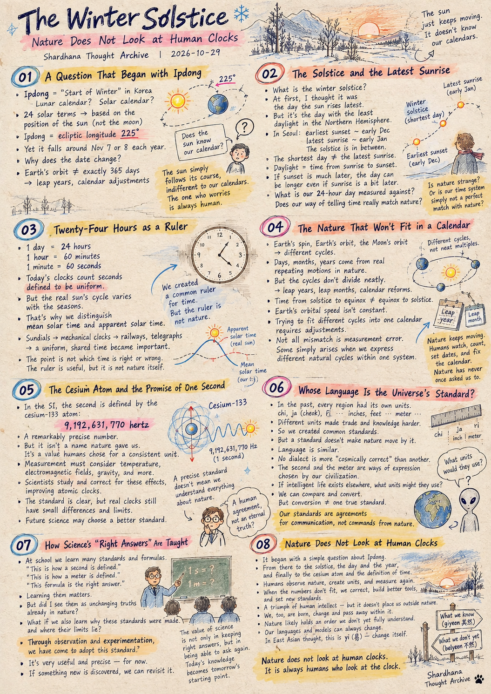
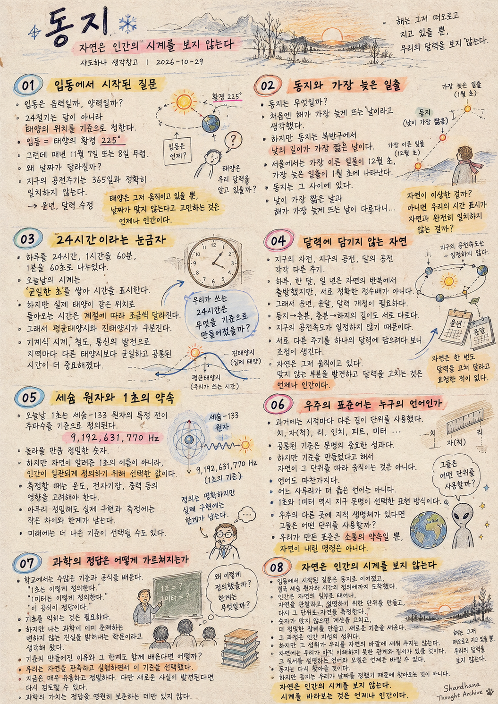

> Location: docs/thoughts/winter-solstice-notes.md

# The Winter Solstice

## Nature Does Not Look at Human Clocks

Shardhana Thought Archive
Date: 2026-10-29

  

---

## 01. A Question That Began with Ipdong

In Korea, *Ipdong* marks the traditional "Start of Winter." Is it set by the lunar calendar or the solar one?

It was a simple curiosity.

The 24 solar terms of the traditional East Asian calendar are based not on the phases of the moon but on the position of the sun. Ipdong is the moment the sun reaches an ecliptic longitude of 225 degrees.

Yet Ipdong falls around November 7 or 8 each year — and not always on the same day.

If it is tied to one fixed position of the sun, why does the date move?

Because Earth's orbit doesn't take exactly 365 days. To absorb the difference, humans invented leap years and kept revising their calendars.

Then a strange thought came to me.

Does the sun know our calendar?

Of course not. The sun simply follows its course, indifferent to our calendars.

The one who worries that the dates don't line up is always human.

---

## 02. The Solstice and the Latest Sunrise

From Ipdong, my question drifted to the winter solstice.

What is the winter solstice, really?

At first I assumed it was the day the sun rises latest.

But the winter solstice is the day with the least daylight in the Northern Hemisphere.

In Seoul, the earliest sunset usually comes in early December and the latest sunrise in early January. The solstice sits somewhere in between.

The shortest day and the latest sunrise fall on different days?

That was hard to wrap my head around.

But daylight is simply the time between sunrise and sunset. If sunrise slips a little later while sunset slips later by even more, the day actually gets longer.

Working through that gap raised another question.

What is our 24-hour day actually measured against?

If we kept time by the sun's real motion, would our clocks look different?

Is nature behaving oddly?

Or does the way we display time simply not match nature perfectly?

---

## 03. Twenty-Four Hours as a Ruler

Humans divided the day into 24 hours,

the hour into 60 minutes, and the minute into 60 seconds.

Today's clocks keep time by counting seconds defined to be uniform.

But the time the real sun takes to return to the same spot in the sky shifts slightly with the seasons.

That is why we distinguish *mean* solar time from *apparent* solar time.

People once read the sun's true position from sundials. Then, as mechanical clocks spread and railways and telegraphs connected distant places, a uniform, shared time came to matter more than each town's own solar time.

This same difference helps explain why the solstice and the latest sunrise don't line up: the moment the sun crosses the meridian at "noon" drifts earlier and later through the seasons.

The point here is not which kind of time is right or wrong.

Humans built a common ruler for time so they could compare different natural events and coordinate their lives.

That ruler is enormously useful.

But the ruler is not nature itself.

And it occurred to me:

We could have adjusted the ruler to follow nature. Instead, have we fixed the ruler and plotted nature's motion onto it?

That isn't a mistake.

It's just worth remembering that it was a choice.

---

## 04. The Nature That Won't Fit in a Calendar

Earth's spin. Earth's orbit. The moon's orbit.

Each keeps its own rhythm.

Days, months and years aren't human inventions out of thin air. They grew from real, repeating motions in nature.

But those rhythms don't divide neatly into one another.

So humans added leap years, slipped in leap months, and reformed their calendars again and again.

The stretch from the winter solstice to the spring equinox isn't the same length as the stretch from the spring equinox to the summer solstice.

That's because Earth doesn't travel its orbit at a constant speed.

Try to squeeze nature's cycles into a single calendar, and adjustments become inevitable.

Not all of this mismatch is measurement error. Some of it simply arises when we try to express different natural cycles within a single calendar system.

Step back a little, though, and an amusing picture appears.

Nature goes on with its own motion.

Humans watch, attach numbers, set dates, and calculate again.

And when something doesn't fit, they fix the calendar.

Nature has never once asked us to.

---

## 05. The Cesium Atom and the Promise of One Second

In the end, my questions about time arrived at the second.

In today's International System of Units, the second is defined by fixing the frequency of a specific transition in the cesium-133 atom at exactly 9,192,631,770 hertz.

A breathtakingly precise number.

But it isn't a name nature whispered to us for "one second."

It's a value humans chose so that the unit of time could be defined consistently.

Measuring the actual transition frequency of cesium atoms means accounting for temperature, electromagnetic fields and more. Even gravity's effect on the passage of time can't be ignored.

Scientists have studied and corrected for these effects, steadily pushing atomic clocks to greater accuracy.

That work is remarkable.

Still, having built a precise standard of measurement is not the same as claiming to have understood everything nature might hold.

The human definition of one second is clear-cut.

But when a real atomic clock produces and measures that second, tiny differences and limits remain, no matter how carefully the work is done.

And the door remains open for future science to choose a better standard for time.

Looking back, I realize that as I learned these standards, I came to feel they were unchanging truths built into nature — not agreements that humans chose.

It probably wasn't only because someone taught me that way.

Perhaps it was simply how I took science in.

---

## 06. Whose Language Is the Universe's Standard?

Once, every region had its own units of length.

Korea had the *chi*, the *ja* (also called *cheok*) and the *ri*; elsewhere there were inches and feet; and eventually, the meter.

Mismatched units made trade, technology and scholarship hard to share.

So humans created common standards.

That is one of civilization's great achievements.

But agreeing on a standard doesn't make nature move by those units.

Language works the same way.

No region's dialect is more "cosmically correct" than another's.

The second and the meter are, likewise, ways of expression that Earth's civilization happened to choose.

If intelligent life exists elsewhere in the universe, what units of time and length might they use?

There's no reason they would have to adopt ours.

If we observe the same natural phenomena, we could compare our units and convert between them.

But being able to convert is a different matter from one unit being the universe's only standard.

The standards we make are agreements for communication.

They are not commands that nature handed down to us.

---

## 07. How Science's "Right Answers" Are Taught

At school we learn countless standards and formulas.

"This is how a second is defined."

"This is how a meter is defined."

"This formula is the right answer."

Learning them matters.

Without the basics, it's hard even to begin asking deeper questions.

Of course, not every teacher presented science as unchanging truth.

But looking back, I had come to believe that science was the work of uncovering fixed truths already sitting in nature.

Along the way, I don't think I fully separated the agreements humans make from the phenomena we actually observe.

What if we learned not only the standards, but why they were made and where their limits lie?

"Through observation and experimentation, we have come to adopt this standard."

"For now, it's very useful and very precise."

"So let's use it together."

"But if something new is discovered, we can revisit it."

The value of science lies not only in preserving right answers forever,

but in explaining how we reached them — and being free to ask again when needed.

Today's knowledge becomes tomorrow's starting point.

Maybe that's what people mean when they say learning never ends.

---

## 08. Nature Does Not Look at Human Clocks

It started with a simple question about the date of Ipdong.

That question led to the winter solstice, passed through the day and the year, and finally arrived at the cesium atom and the very definition of time.

Looking back, humans are fascinating creatures.

Born as part of nature, we observe it and invent units to explain it.

Then we measure nature again with the units we made.

When the numbers don't fit, we correct the math, build finer instruments, and set new standards.

That process is a triumph of the human mind.

But that triumph doesn't place us outside nature.

We, too, are born, change and pass away within it.

I don't believe nature moves without any rules.

If anything, it holds relationships and an order we don't yet fully understand.

What I do believe is that the human languages and models we use to describe that order can always change.

In East Asian thought, that is *yi* (易) — change itself.

As the realm of *giyeon* (其然) — what we can already explain — grows wider, yesterday's *bulyeon* (不然) — what once seemed beyond explanation — can be understood anew.

And the boundary between them isn't fixed either.

This reading of *giyeon* and *bulyeon* is my own reflection, inspired by *Bulyeon Giyeon* ("What Is Not So, and What Is So"), an essay by Choe Je-u, the 19th-century Korean thinker who founded Donghak.

This is why Shardhana seeks to take nature as its teacher:

not to bend nature to fit human models, but to keep reshaping our models as we watch nature.

The winter solstice will come again.

Humans will calculate the day and mark it on the calendar.

But the solstice doesn't arrive because we set the date.

Nature does not look at human clocks.

It is always humans who look at the clock.

---

*Shardhana Thought Archive*

This piece records observations and reflections that began with everyday questions about Ipdong and the winter solstice. It draws on astronomical facts and the definitions of time units, but its views on science and human perception are personal reflections, not settled scientific conclusions.

This document was prepared with the assistance of Shana (GPT) and Laude (Claude).

---
 
 

# 동지

## 자연은 인간의 시계를 보지 않는다

샤드하나 생각창고
작성일: 2026-10-29

  

---

## 01. 입동에서 시작된 질문

입동은 음력으로 정해지는 날일까, 양력으로 정해지는 날일까.

단순한 궁금증이었다.

24절기는 달의 모양이 아니라 태양의 위치를 기준으로 정한다. 입동은 태양의 황경이 225도가 되는 순간이다.

그런데 입동은 매년 양력 11월 7일이나 8일 무렵에 찾아온다.

왜 같은 태양의 위치를 기준으로 정했는데 날짜가 달라질까.

지구의 공전주기는 달력의 365일과 정확히 일치하지 않는다. 인간은 그 차이를 조정하기 위해 윤년을 만들고, 달력을 수정해 왔다.

문득 이상한 생각이 들었다.

태양은 인간의 달력을 알고 있을까.

아니, 태양은 그저 움직이고 있을 뿐이다.

날짜가 맞지 않는다고 고민하는 것은 언제나 인간이다.

---

## 02. 동지와 가장 늦은 일출

입동에서 시작된 질문은 동지로 이어졌다.

동지는 무엇일까.

처음에는 해가 가장 늦게 뜨는 날이라고 생각했다.

하지만 동지는 북반구에서 낮의 길이가 가장 짧은 날이다.

서울에서는 가장 이른 일몰이 대체로 12월 초에, 가장 늦은 일출은 1월 초에 나타난다. 동지는 그 사이에 있다.

낮이 가장 짧은 날과 해가 가장 늦게 뜨는 날이 다르다니.

처음에는 이해하기 어려웠다.

그러나 낮의 길이는 일출부터 일몰까지의 시간이다. 일출이 조금 늦어지더라도 일몰이 더 많이 늦어진다면 낮은 오히려 길어진다.

이 차이를 이해하다 보니 또 다른 의문이 생겼다.

우리가 사용하는 24시간은 무엇을 기준으로 만들어졌을까.

태양의 실제 움직임을 기준으로 시간을 표시한다면, 우리가 보는 시계의 모습도 달라질 수 있지 않을까.

자연이 이상한 것일까.

아니면 인간의 시간 표시 방식이 자연과 완전히 일치하지 않는 것일까.

---

## 03. 24시간이라는 눈금자

인간은 하루를 24시간으로 나누었다.

그리고 1시간을 60분, 1분을 60초로 나누었다.

오늘날의 시계는 균일한 초를 쌓아 시간을 표시한다.

하지만 실제 태양이 하늘에서 같은 위치로 돌아오는 데 걸리는 시간은 계절에 따라 조금씩 달라진다.

평균태양시와 진태양시가 구분되는 이유다.

과거 사람들은 해시계로 태양의 실제 위치를 읽었다. 이후 기계식 시계가 보급되고 철도와 통신이 발달하면서, 지역마다 다른 태양시보다 균일하고 공통된 시간이 중요해졌다.

동지와 가장 늦은 일출이 일치하지 않는 현상에도 이러한 시간의 차이가 관계되어 있다. 태양이 정오에 남중하는 시각이 계절에 따라 달라지기 때문이다.

여기서 중요한 것은 어느 시간이 옳고 그르냐가 아니다.

인간은 서로 다른 자연현상을 비교하고 생활을 조정하기 위해 공통된 시간의 눈금자를 만들었다.

그 눈금자는 매우 유용하다.

하지만 눈금자가 자연 그 자체는 아니다.

나는 문득 생각했다.

자연의 움직임에 맞춰 눈금자를 바꿀 수도 있는데, 우리는 눈금자를 고정하고 자연의 움직임을 그 안에 표시하고 있는 것은 아닐까.

그것이 잘못이라는 뜻은 아니다.

다만 우리가 선택한 방법이라는 사실을 잊지 말자는 것이다.

---

## 04. 달력에 담기지 않는 자연

지구의 자전, 지구의 공전, 달의 공전.

이들은 서로 다른 주기를 가진다.

하루와 한 달, 일 년은 인간이 임의로 상상해 낸 현상은 아니다. 실제 자연의 반복되는 움직임에서 출발한 개념이다.

하지만 그 주기들은 서로 정확한 정수배 관계를 이루지 않는다.

그래서 인간은 윤년을 만들고, 윤달을 두고, 달력을 개정해 왔다.

동지에서 춘분까지 걸리는 시간도, 춘분에서 하지까지 걸리는 시간도 서로 같지 않다.

지구의 공전속도가 일정하지 않기 때문이다.

자연의 주기를 하나의 달력에 담으려니 조정이 필요해진다.

이 차이는 모두 측정 오차라는 뜻은 아니다. 서로 다른 주기를 하나의 체계로 표현하면서 생기는 불일치도 있다.

그런데 조금 멀리서 바라보면 재미있는 장면이 펼쳐진다.

자연은 자기 운동을 계속하고 있다.

인간은 그 움직임을 관찰하며 숫자를 붙이고, 날짜를 정하고, 다시 계산한다.

그리고 맞지 않는 부분을 발견하면 달력을 고친다.

자연은 한 번도 인간에게 달력을 고쳐 달라고 요청한 적이 없다.

---

## 05. 세슘 원자와 1초의 약속

시간에 대한 질문은 결국 1초에 도착했다.

오늘날 국제단위계에서 1초는 세슘-133 원자의 특정 전이 주파수를 기준으로 정의된다.

9,192,631,770.

놀라울 만큼 정밀한 숫자다.

하지만 이 숫자는 자연이 인간에게 알려준 1초의 이름이 아니다.

인간이 시간의 단위를 일관되게 정의하기 위해 선택한 값이다.

세슘 원자의 실제 전이 주파수를 측정할 때에는 온도, 전자기장 등의 영향을 고려해야 한다. 중력에 따른 시간 측정의 차이도 무시할 수 없다.

과학자들은 이러한 영향을 연구하고 보정하면서 원자시계의 정확도를 높여 왔다.

그 노력은 대단하다.

그러나 정밀한 측정 기준을 마련했다는 사실과 자연의 모든 가능성을 완전히 이해했다는 주장은 다르다.

인간이 정한 1초의 기준은 명확하다.

하지만 실제 원자시계로 그 시간을 구현하고 측정하는 과정에서는 아무리 정밀하게 작업하더라도 작은 차이와 한계가 남는다.

그리고 미래의 과학이 더 나은 시간의 기준을 선택할 가능성도 열려 있다.

돌아보면 나는 이런 기준을 배우면서, 그것이 인간이 선택한 약속이라기보다 자연에 원래부터 존재하는 불변의 진리처럼 느껴 왔다.

누군가 그렇게 가르쳤기 때문만은 아닐 것이다.

어쩌면 내가 과학을 받아들이는 방식 자체가 그랬는지도 모른다.

---

## 06. 우주의 표준어는 누구의 언어인가

과거에는 지역마다 길이를 재는 단위가 달랐다.

치, 자(척), 리, 인치, 피트, 미터.

서로 다른 단위는 교역과 기술, 학문의 소통을 어렵게 만들었다.

그래서 인간은 공통된 기준을 만들었다.

이것은 문명의 중요한 성과다.

하지만 공통 기준을 만들었다고 해서 자연이 그 단위를 따라 움직이는 것은 아니다.

언어도 마찬가지다.

어느 지역의 사투리가 다른 지역의 말보다 우주적으로 더 옳은 언어인 것은 아니다.

인간이 만든 1초와 1미터 역시 지구 문명이 선택한 표현 방식이다.

만약 우주의 다른 곳에 지적 생명체가 있다면 그들은 어떤 시간과 길이의 단위를 사용할까.

우리가 사용하는 단위를 그대로 받아들여야 할 이유는 없다.

서로 같은 자연현상을 관측한다면 단위를 비교하고 환산할 수는 있을 것이다.

그러나 환산할 수 있다는 것과 하나의 단위가 우주의 유일한 기준이라는 것은 다른 이야기다.

우리가 만든 표준은 소통의 약속이다.

자연이 인간에게 내린 명령은 아니다.

---

## 07. 과학의 정답은 어떻게 가르쳐지는가

학교에서는 수많은 기준과 공식을 배운다.

1초는 이렇게 정의한다.

1미터는 이렇게 정의한다.

이 공식이 정답이다.

그것을 익히는 일은 필요하다.

기초 지식이 없다면 더 깊은 질문을 시작하기도 어렵다.

물론 모든 선생님이 과학을 불변의 진리처럼 가르친 것은 아닐 것이다.

하지만 돌이켜 보면, 나는 과학이 자연 속에 이미 존재하는 변하지 않는 진실을 밝혀내는 학문이라고 생각해 왔다.

그 과정에서 인간이 정한 약속과 자연에서 관측한 현상을 충분히 구분하지 못했던 것 같다.

기준이 만들어진 이유와 그 한계를 함께 배운다면 어떨까.

우리는 지금까지 자연을 관측하고 실험하면서 이 기준을 선택했다.

현재로서는 매우 유용하고 정밀하다.

그러니 함께 사용해 보자.

다만 새로운 사실이 발견된다면 이 기준도 다시 검토할 수 있다.

과학의 가치는 정답을 영원히 보존하는 데만 있지 않다.

어떤 근거로 그 정답에 도달했는지 설명하고, 필요하다면 다시 질문할 수 있다는 데에도 있다.

오늘의 지식이 내일의 출발점이 되는 것.

배움에 끝이 없다는 말은 어쩌면 그런 뜻일 것이다.

---

## 08. 자연은 인간의 시계를 보지 않는다

처음에는 입동 날짜가 궁금했다.

그 질문은 동지로 이어졌고, 하루와 일 년을 지나, 결국 세슘 원자와 시간의 정의에까지 도착했다.

돌아보면 인간은 참 흥미로운 존재다.

자연의 일부로 태어나 자연을 관찰하고, 자연을 설명하기 위한 단위를 만들었다.

그리고 자신이 만든 단위로 다시 자연을 측정한다.

숫자가 맞지 않으면 계산을 고치고, 더 정밀한 장비를 만들고, 새로운 기준을 세운다.

그 과정은 인간 지성의 성취다.

그러나 그 성취가 인간을 자연의 바깥에 세워 주지는 않는다.

인간 역시 자연 속에서 태어나고 변하고 사라지는 존재이기 때문이다.

나는 자연이 아무 규칙 없이 움직인다고 생각하지 않는다.

오히려 자연에는 우리가 아직 충분히 이해하지 못한 관계와 질서가 있을 것이다.

다만 그 질서를 설명하는 인간의 언어와 모델은 언제든 바뀔 수 있다고 생각한다.

그것이 역(易)이다.

오늘 우리가 아는 기연(其然)의 세계가 넓어지면, 어제의 불연(不然)도 새롭게 이해될 수 있다.

그리고 그 경계 역시 고정되어 있지 않다.

이러한 기연과 불연의 해석은 최제우의 「불연기연」에서 출발한 개인적인 사유다.

샤드하나가 자연을 스승으로 삼으려는 이유도 여기에 있다.

자연을 인간의 모델에 맞추려는 것이 아니라, 자연을 관찰하면서 모델을 바꾸어 가는 것.

동지는 다시 찾아올 것이다.

인간은 그날을 계산하고 달력에 표시할 것이다.

하지만 동지는 인간이 날짜를 정했기 때문에 찾아오는 것이 아니다.

자연은 인간의 시계를 보지 않는다.

시계를 바라보는 것은 언제나 인간이다.

---

*샤드하나 생각창고*

이 글은 입동과 동지에 관한 일상적인 질문에서 출발한 관찰과 사유의 기록이다. 천문학적 사실과 시간 단위의 정의를 바탕으로 하되, 과학과 인간의 인식에 관한 해석은 개인적인 생각이며 확정된 과학적 결론을 뜻하지 않는다.

이 문서는 샤나(GPT)와 로드(Claude)의 도움을 받아 작성되었습니다.
